# Implementing Prevention Methods for String Vulnerabilities

**Mini Project Report — CYE551: Secure Coding Using C/C++**

Department of Computer Science and Engineering (Cyber Security)
M. S. Ramaiah Institute of Technology (MSRIT), Bengaluru
B.E. 5th Semester

| Team member      | USN        |
|------------------|------------|
| Yuval            | 1MS24CY021 |
| Anand            | 1MS24CY010 |
| Sathish Kumar S  | 1MS24CY055 |

**Guide:** Prof. Shankaramma

**Repository:** `https://github.com/Anand8k7/string-vuln-prevention`

> **About the outputs in this report.** Every program output, test table and
> analysis log below was produced by actually compiling and running the code
> in this repository. The blocks marked *Real output* are copied
> automatically from `docs/report/outputs/` by `docs/report/render_report.py`,
> and those files are written by `docs/report/collect_outputs.sh`, which runs
> exactly the commands shown. Memory addresses and process IDs change from run
> to run; everything else is reproducible with
> `bash docs/report/collect_outputs.sh && python3 docs/report/render_report.py`.

---

## Table of contents

1. [Introduction](#1-introduction)
2. [System design](#2-system-design)
3. [Safe string library and input handler](#3-safe-string-library-and-input-handler)
4. [Q1 — Buffer overflow via `strcpy` / `strcat`](#4-q1--buffer-overflow-via-strcpy--strcat)
5. [Q2 — Improper input validation and unsafe formatting](#5-q2--improper-input-validation-and-unsafe-formatting)
6. [Vulnerability detection and analysis (Module 4)](#6-vulnerability-detection-and-analysis-module-4)
7. [Testing and evaluation (Module 5)](#7-testing-and-evaluation-module-5)
8. [Continuous integration](#8-continuous-integration)
9. [Conclusion and future work](#9-conclusion-and-future-work)
10. [References](#10-references)
- [Appendix A — Reproducing every result](#appendix-a--reproducing-every-result)
- [Appendix B — List of figures (screenshots)](#appendix-b--list-of-figures-screenshots)

---

## Abstract

C represents a string as a `char` array ending in `'\0'`, and the classic
library functions that work on strings (`strcpy`, `strcat`, `sprintf`,
`scanf("%s")`, `printf(str)`) do not know how large the destination buffer is
or whether their input can be trusted. This project demonstrates two families
of string vulnerabilities in deliberately unsafe programs — buffer overflow
through `strcpy`/`strcat` (Q1), and missing input validation combined with
unsafe formatting (Q2) — and then removes them with a small safe-string
library, a validated input pipeline and fixed format strings.

The vulnerable programs were shown to overwrite a neighbouring struct field,
corrupt adjacent stack buffers, overwrite the saved return address
(Valgrind: *Jump to the invalid address 0x4141414141414141*), print stack
memory and leak a simulated secret through `%p`/`%27$lx`, and crash on
`%s%s%s…`. The secure versions reject every one of those inputs and pass all
**123/123** automated tests under AddressSanitizer. Static and dynamic analysis
(gcc warnings, Cppcheck, a banned-API scanner, AddressSanitizer and Valgrind)
reports **0 findings in the secure code** against 5 compiler warnings, 3
Cppcheck findings, 16 banned-API calls, 4 ASan stack-buffer-overflows and
3 Valgrind crashes in the vulnerable code. The analysis also shows the limits
of each tool: ASan misses the overflow that stays inside a struct, Cppcheck
misses `strcpy`, `sprintf` and `printf(msg)`, and none of the tools detects
missing input validation — which is why the secure design combines several
layers.

---

## 1. Introduction

### 1.1 Problem statement

String handling is one of the most common sources of memory-safety bugs in C.
A function such as `strcpy(dst, src)` copies until it finds `'\0'` in `src`;
if `src` is longer than `dst`, the extra bytes are written over whatever lies
next to `dst` in memory — other variables, the saved frame pointer or the
return address. Format functions add a second class of bugs: if user text is
passed as the *format* argument of `printf`, every `%` in it is interpreted
and makes `printf` read (or write) arguments that were never passed.

### 1.2 Objectives

1. Build deliberately vulnerable programs that show these bugs on real input.
2. Build secure versions that follow a defined workflow: **User Input → Input
   Validation → Length & Boundary Checking → Safe String Handling → Output
   Verification → Result**.
3. Provide a reusable safe-string library (`safe_copy`, `safe_concat`,
   `safe_format`, `validate_input`, …) with guaranteed termination and
   reported truncation.
4. Detect the vulnerabilities with Cppcheck, AddressSanitizer and Valgrind,
   and compare vulnerable versus secure code.
5. Test both versions with normal, boundary, invalid and oversized inputs.

### 1.3 Scope and safety

All programs read only local input (command-line arguments, keyboard /
redirected stdin, local files). The vulnerable programs are compiled without
stack protector and FORTIFY_SOURCE **only** so the bugs can be observed. No
exploit payload is used: the overflow tests use runs of the letter `A`, and
the format-string tests only *read* memory (`%p`, `%lx`, `%s`); no `%n`
(memory write) input is used.

---

## 2. System design

### 2.1 Workflow

```
 ┌────────────┐   ┌──────────────────┐   ┌────────────────────────┐
 │ User Input │──▶│ Input Validation │──▶│ Length & Boundary Check │
 └────────────┘   └──────────────────┘   └────────────────────────┘
                                                     │
 ┌────────┐   ┌─────────────────────┐   ┌────────────▼─────────┐
 │ Result │◀──│ Output Verification │◀──│ Safe String Handling │
 └────────┘   └─────────────────────┘   └──────────────────────┘
       any step fails ──▶ REJECTED: <reason>   (exit code 2)
```

| Step | Implementation in the secure programs |
|------|----------------------------------------|
| User Input | `input_read_line()` (bounded `fgets`), `input_from_arg()` (bounded copy of `argv`) |
| Input Validation | `validate_input()` (whitelist of characters, min/max length), `validate_integer()` (strict number parser with range) |
| Length & Boundary Checking | every status code is checked; `IN_TOO_LONG` and `SS_TRUNCATED` cause a rejection |
| Safe String Handling | `safe_copy()`, `safe_concat()`, `safe_format()` |
| Output Verification | results are terminated within their buffers; neighbouring data (e.g. `role`) unchanged |
| Result | printed only through fixed format strings (`printf("%s\n", msg)`) |

### 2.2 Modules

| # | Module | Files |
|---|--------|-------|
| 1 | Input Handling | `src/lib/input_handler.h`, `src/lib/input_handler.c` |
| 2 | Validation | `validate_input`, `validate_integer` in `src/lib/safe_string.c` |
| 3 | Safe String Operations | `safe_copy`, `safe_concat`, `safe_format`, `safe_strlen` in `src/lib/safe_string.c` |
| 4 | Vulnerability Detection / Analysis | `analysis/run_analysis.sh`, `analysis/banned_functions.py` |
| 5 | Testing & Evaluation | `tests/test_safe_string.c`, `tests/test_input_handler.c`, `tests/scenarios/*.sh`, `tests/run_tests.sh` |

### 2.3 Repository structure

```
string-vuln-prevention/
├── src/vulnerable/     q1_overflow.c, q2_format.c      (deliberately unsafe)
├── src/secure/         q1_overflow.c, q2_format.c      (fixed versions)
├── src/lib/            safe_string.h/.c, input_handler.h/.c
├── tests/              unit tests, test_framework.h, run_tests.sh
│   └── scenarios/      q1_overflow.sh, q2_format.sh, lib_scenario.sh
├── analysis/           run_analysis.sh, banned_functions.py, logs/
├── docs/report/        report.md, collect_outputs.sh, render_report.py, outputs/
├── screenshots/        terminal captures (see Appendix B)
├── Makefile
└── .github/workflows/ci.yml
```

**Figure 2 — repository structure**
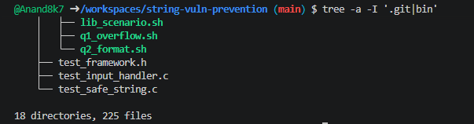
*Placeholder — capture with: `tree -a -I '.git|bin'`*

### 2.4 Build configurations

The same source is built three ways (`Makefile`):

| Build | Output | Key flags | Purpose |
|-------|--------|-----------|---------|
| vulnerable | `bin/vulnerable/` | `-O0 -g -fno-stack-protector -D_FORTIFY_SOURCE=0` | protections off so bugs are observable |
| secure | `bin/secure/` | `-Wall -Wextra -Werror -Wpedantic -Wformat=2 -Wformat-security -Wformat-overflow=2 -Wformat-truncation=2 -Wstringop-overflow=4 -Wshadow -Wconversion -Wsign-conversion -O2 -D_FORTIFY_SOURCE=2 -fstack-protector-strong -fPIE -pie -Wl,-z,relro,-z,now` | warnings are errors + compiler/linker hardening |
| asan | `bin/asan/` | `-O1 -g -fno-omit-frame-pointer -fsanitize=address,undefined -D_FORTIFY_SOURCE=0` | run-time detection; FORTIFY disabled because Ubuntu's gcc enables it by default at `-O1` and it aborted before ASan could report |

Make targets: `make all`, `make vulnerable`, `make secure`, `make asan`,
`make test`, `make analyze`, `make clean`, `make help`.

**Figure 3 — make targets**
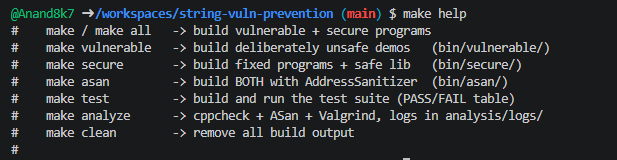
*Placeholder — capture with: `make help`*

---

## 3. Safe string library and input handler

### 3.1 Design rules

Every function in `src/lib/` follows four rules:

1. The caller passes the **total** buffer size (`sizeof buf`), never `size - 1`.
2. Nothing is written at or beyond `dst[dst_size - 1]` except the `'\0'`.
3. If `dst` and `dst_size` are valid, `dst` is **always** terminated on return,
   even on error.
4. Truncation is **reported**, never silent. The library truncates safely and
   returns `SS_TRUNCATED` / `IN_TOO_LONG`; the secure programs treat that
   status as "reject the input".

Sizes larger than `SS_MAX_SIZE` (`SIZE_MAX >> 1`) are rejected, because such a
size almost always comes from a negative `int` converted to `size_t`
(CWE-195).

| Function | Replaces | Result codes |
|----------|----------|--------------|
| `safe_copy(dst, size, src)` | `strcpy`, `strncpy` | `SS_OK`, `SS_TRUNCATED`, `SS_ERR_NULL`, `SS_ERR_SIZE` |
| `safe_concat(dst, size, src)` | `strcat`, `strncat` | as above + `SS_ERR_UNTERMINATED` |
| `safe_format(dst, size, fmt, ...)` | `sprintf` | as above + `SS_ERR_FORMAT`; has `__attribute__((format(printf,3,4)))` so gcc checks every call |
| `safe_strlen(s, max)` | `strlen` on untrusted data | never reads more than `max` bytes |
| `validate_input(s, min, max, charset, extra, &pos)` | ad-hoc checks | `VAL_OK`, `VAL_ERR_EMPTY`, `VAL_ERR_TOO_LONG`, `VAL_ERR_BAD_CHAR` (+ position) |
| `validate_integer(s, min, max, &out)` | `atoi`, `scanf("%d")` | `VAL_OK`, `VAL_ERR_NOT_NUMBER`, `VAL_ERR_RANGE` |
| `input_read_line(fp, buf, size, &len)` | `gets`, `scanf("%s")` | `IN_OK`, `IN_TOO_LONG` (rest of line drained), `IN_EOF`, `IN_ERR_NUL_BYTE` |
| `input_from_arg(argc, argv, i, buf, size)` | `strcpy(buf, argv[i])` | `IN_OK`, `IN_TOO_LONG`, `IN_ERR_MISSING` |
| `input_read_file(path, buf, size, &len)` | unchecked `fread` | `IN_OK`, `IN_TOO_LONG`, `IN_ERR_IO` |

Two details worth noting:

* `input_read_line` drains the rest of an over-long line, so leftover
  characters cannot be read as the *next* field (the "input desync" seen in
  the vulnerable Q2).
* `input_read_line` detects an embedded `'\0'` byte (CWE-158): it pre-fills
  the buffer, finds the terminator written by `fgets`, and compares that
  position with `strlen`.

### 3.2 Library source code

<!-- BEGIN CODE src/lib/safe_string.h c -->
*Source file — `src/lib/safe_string.h`*

```c
/*
 * safe_string.h - Bounded, always-terminated string operations
 *
 * CYE551 Mini Project: Implementing Prevention Methods for String Vulnerabilities
 * Module 2 (Validation) and Module 3 (Safe String Operations)
 *
 * Rules every function in this library follows:
 *   1. The caller always passes the TOTAL size of the destination buffer
 *      (sizeof(buf) for arrays), never "size - 1".
 *   2. Nothing is ever written at or beyond dst[dst_size - 1] except the
 *      terminating '\0'.
 *   3. If dst is non-NULL and dst_size is valid, dst is ALWAYS '\0'-terminated
 *      when the function returns, even on error.
 *   4. Truncation is never silent: it is reported through the return value so
 *      the caller can decide to reject the input.
 */
#ifndef SAFE_STRING_H
#define SAFE_STRING_H

#include <stddef.h>

/* Largest buffer size accepted. A size above this almost certainly came from
 * a negative signed value that was converted to size_t (CWE-195), so it is
 * rejected instead of being trusted. Same idea as RSIZE_MAX in C11 Annex K. */
#define SS_MAX_SIZE ((size_t)-1 >> 1)

/* Result codes shared by all string operations. */
typedef enum {
    SS_OK = 0,          /* operation completed, result fits                 */
    SS_TRUNCATED,       /* result did not fit; dst holds a terminated prefix */
    SS_ERR_NULL,        /* a required pointer was NULL                       */
    SS_ERR_SIZE,        /* dst_size is 0 or larger than SS_MAX_SIZE          */
    SS_ERR_UNTERMINATED,/* safe_concat: dst had no '\0' inside dst_size      */
    SS_ERR_FORMAT       /* safe_format: the formatting itself failed         */
} ss_status;

/* Bit flags selecting which character classes validate_input() accepts. */
#define CHARSET_ALPHA  0x01u   /* A-Z a-z                  */
#define CHARSET_DIGIT  0x02u   /* 0-9                      */
#define CHARSET_SPACE  0x04u   /* ' ' (space only, no tabs) */
#define CHARSET_ALNUM  (CHARSET_ALPHA | CHARSET_DIGIT)

/* Result codes for validation. */
typedef enum {
    VAL_OK = 0,
    VAL_ERR_NULL,       /* input pointer was NULL                     */
    VAL_ERR_EMPTY,      /* input is shorter than min_len              */
    VAL_ERR_TOO_LONG,   /* input is longer than max_len               */
    VAL_ERR_BAD_CHAR,   /* input contains a character not whitelisted */
    VAL_ERR_NOT_NUMBER, /* validate_integer: not a plain decimal int  */
    VAL_ERR_RANGE       /* validate_integer: outside [min, max]       */
} val_status;

/* ------------------------------------------------------------------------- */
/* Module 3: Safe string operations                                          */
/* ------------------------------------------------------------------------- */

/* Length of s, but never reads more than max bytes. Returns max if no '\0'
 * was found in the first max bytes. NULL -> 0. (Portable strnlen.) */
size_t safe_strlen(const char *s, size_t max);

/* Replacement for strcpy/strncpy. Copies src into dst (size dst_size),
 * always terminates, reports truncation. */
ss_status safe_copy(char *dst, size_t dst_size, const char *src);

/* Replacement for strcat/strncat. Appends src to the string already in dst.
 * dst_size is the TOTAL size of dst (not the space left). */
ss_status safe_concat(char *dst, size_t dst_size, const char *src);

/* Replacement for sprintf. printf-style formatting into dst; always
 * terminates, reports truncation. The format attribute lets the compiler
 * check every call site's arguments (-Wformat). */
ss_status safe_format(char *dst, size_t dst_size, const char *fmt, ...)
#if defined(__GNUC__)
    __attribute__((format(printf, 3, 4)))
#endif
    ;

/* Human-readable name of a status code (for messages and test output). */
const char *ss_status_str(ss_status st);

/* ------------------------------------------------------------------------- */
/* Module 2: Validation                                                      */
/* ------------------------------------------------------------------------- */

/* Whitelist validation. Accepts s only if
 *     min_len <= strlen(s) <= max_len
 * and every character belongs to one of the classes in `charset` or appears
 * in `extra_allowed` (may be NULL). Only ASCII is accepted; control
 * characters and bytes >= 0x80 are always rejected unless listed in
 * extra_allowed.
 * If bad_pos is non-NULL and a bad character is found, its index is stored. */
val_status validate_input(const char *s, size_t min_len, size_t max_len,
                          unsigned charset, const char *extra_allowed,
                          size_t *bad_pos);

/* Strict decimal integer parser (replacement for atoi / scanf("%d")).
 * Accepts an optional leading '-' followed by one or more digits and nothing
 * else (no spaces, no '+', no trailing junk). Values that overflow `long` or
 * fall outside [min, max] give VAL_ERR_RANGE. Stores the value in *out only
 * on success. */
val_status validate_integer(const char *s, long min, long max, long *out);

const char *val_status_str(val_status st);

#endif /* SAFE_STRING_H */
```
<!-- END CODE -->

<!-- BEGIN CODE src/lib/safe_string.c c -->
*Source file — `src/lib/safe_string.c`*

```c
/*
 * safe_string.c - Implementation of the safe string library
 *
 * CYE551 Mini Project: Implementing Prevention Methods for String Vulnerabilities
 *
 * See safe_string.h for the contract. In short: every function takes the
 * full destination size, never writes past it, always leaves a '\0', and
 * reports truncation instead of hiding it.
 */
#include "safe_string.h"

#include <errno.h>
#include <stdarg.h>
#include <stdio.h>
#include <stdlib.h>
#include <string.h>

/* ------------------------------------------------------------------------- */
/* Helpers                                                                   */
/* ------------------------------------------------------------------------- */

/* A destination size is valid if it leaves room for at least the '\0' and
 * does not look like a negative number converted to size_t. */
static int size_is_valid(size_t n)
{
    return n > 0 && n <= SS_MAX_SIZE;
}

size_t safe_strlen(const char *s, size_t max)
{
    size_t n = 0;

    if (s == NULL) {
        return 0;
    }
    /* Stop at max even if no terminator is found: never read past it. */
    while (n < max && s[n] != '\0') {
        n++;
    }
    return n;
}

/* ------------------------------------------------------------------------- */
/* safe_copy: bounded strcpy                                                 */
/* ------------------------------------------------------------------------- */
ss_status safe_copy(char *dst, size_t dst_size, const char *src)
{
    size_t src_len;
    size_t n;

    if (dst == NULL) {
        return SS_ERR_NULL;
    }
    if (!size_is_valid(dst_size)) {
        return SS_ERR_SIZE;           /* cannot even store '\0' safely */
    }
    if (src == NULL) {
        dst[0] = '\0';                /* leave dst as a valid empty string */
        return SS_ERR_NULL;
    }

    /* Only look at dst_size bytes of src: if it is that long we already
     * know it will not fit, no need to scan further. */
    src_len = safe_strlen(src, dst_size);
    n = (src_len < dst_size) ? src_len : dst_size - 1;

    /* memmove instead of memcpy: correct even if src and dst overlap. */
    memmove(dst, src, n);
    dst[n] = '\0';                    /* guaranteed termination */

    return (src_len < dst_size) ? SS_OK : SS_TRUNCATED;
}

/* ------------------------------------------------------------------------- */
/* safe_concat: bounded strcat                                               */
/* ------------------------------------------------------------------------- */
ss_status safe_concat(char *dst, size_t dst_size, const char *src)
{
    size_t dst_len;

    if (dst == NULL) {
        return SS_ERR_NULL;
    }
    if (!size_is_valid(dst_size)) {
        return SS_ERR_SIZE;
    }

    /* Find the current end of dst WITHOUT reading past the buffer. If there
     * is no '\0' inside dst_size, dst is already corrupt: terminate it at
     * the last byte and refuse to append. */
    dst_len = safe_strlen(dst, dst_size);
    if (dst_len == dst_size) {
        dst[dst_size - 1] = '\0';
        return SS_ERR_UNTERMINATED;
    }
    if (src == NULL) {
        return SS_ERR_NULL;           /* dst untouched and still terminated */
    }

    /* Append into the remaining space; safe_copy does the bounds work. */
    return safe_copy(dst + dst_len, dst_size - dst_len, src);
}

/* ------------------------------------------------------------------------- */
/* safe_format: bounded sprintf                                              */
/* ------------------------------------------------------------------------- */
ss_status safe_format(char *dst, size_t dst_size, const char *fmt, ...)
{
    va_list ap;
    int written;

    if (dst == NULL) {
        return SS_ERR_NULL;
    }
    if (!size_is_valid(dst_size)) {
        return SS_ERR_SIZE;
    }
    if (fmt == NULL) {
        dst[0] = '\0';
        return SS_ERR_NULL;
    }

    /* vsnprintf writes at most dst_size bytes including the '\0' and
     * returns the length the full result WOULD have had. */
    va_start(ap, fmt);
    written = vsnprintf(dst, dst_size, fmt, ap);
    va_end(ap);

    if (written < 0) {
        dst[0] = '\0';                /* encoding error: leave dst empty */
        return SS_ERR_FORMAT;
    }
    if ((size_t)written >= dst_size) {
        return SS_TRUNCATED;          /* vsnprintf already terminated it */
    }
    return SS_OK;
}

const char *ss_status_str(ss_status st)
{
    switch (st) {
    case SS_OK:               return "SS_OK";
    case SS_TRUNCATED:        return "SS_TRUNCATED";
    case SS_ERR_NULL:         return "SS_ERR_NULL";
    case SS_ERR_SIZE:         return "SS_ERR_SIZE";
    case SS_ERR_UNTERMINATED: return "SS_ERR_UNTERMINATED";
    case SS_ERR_FORMAT:       return "SS_ERR_FORMAT";
    }
    return "SS_UNKNOWN";
}

/* ------------------------------------------------------------------------- */
/* Validation                                                                */
/* ------------------------------------------------------------------------- */

/* Explicit ASCII ranges instead of <ctype.h>: the result must not depend on
 * the current locale, and isalpha() on a negative char is undefined. */
static int char_allowed(unsigned char c, unsigned charset, const char *extra)
{
    if ((charset & CHARSET_ALPHA) &&
        ((c >= 'A' && c <= 'Z') || (c >= 'a' && c <= 'z'))) {
        return 1;
    }
    if ((charset & CHARSET_DIGIT) && c >= '0' && c <= '9') {
        return 1;
    }
    if ((charset & CHARSET_SPACE) && c == ' ') {
        return 1;
    }
    if (extra != NULL && c != '\0' && strchr(extra, (int)c) != NULL) {
        return 1;
    }
    return 0;
}

val_status validate_input(const char *s, size_t min_len, size_t max_len,
                          unsigned charset, const char *extra_allowed,
                          size_t *bad_pos)
{
    size_t len;
    size_t i;

    if (s == NULL) {
        return VAL_ERR_NULL;
    }

    /* Bounded length check first: read at most max_len + 1 bytes, which is
     * enough to know whether the input is too long. (Guard the +1 so a
     * huge max_len cannot wrap around to 0.) */
    len = safe_strlen(s, (max_len < SS_MAX_SIZE) ? max_len + 1 : max_len);
    if (len > max_len) {
        return VAL_ERR_TOO_LONG;
    }
    if (len < min_len) {
        return VAL_ERR_EMPTY;
    }

    /* Whitelist: reject on the first character that is not allowed. */
    for (i = 0; i < len; i++) {
        if (!char_allowed((unsigned char)s[i], charset, extra_allowed)) {
            if (bad_pos != NULL) {
                *bad_pos = i;
            }
            return VAL_ERR_BAD_CHAR;
        }
    }
    return VAL_OK;
}

val_status validate_integer(const char *s, long min, long max, long *out)
{
    const char *p;
    char *end = NULL;
    long value;

    if (s == NULL || out == NULL) {
        return VAL_ERR_NULL;
    }
    if (s[0] == '\0') {
        return VAL_ERR_EMPTY;
    }

    /* Format check: optional '-', then one or more digits, nothing else.
     * strtol alone would accept " 42", "+42" and "42abc". */
    p = (s[0] == '-') ? s + 1 : s;
    if (*p == '\0') {
        return VAL_ERR_NOT_NUMBER;
    }
    for (; *p != '\0'; p++) {
        if (*p < '0' || *p > '9') {
            return VAL_ERR_NOT_NUMBER;
        }
    }

    /* Overflow check: strtol sets errno = ERANGE (atoi would silently
     * return garbage). */
    errno = 0;
    value = strtol(s, &end, 10);
    if (errno == ERANGE || end == s || *end != '\0') {
        return VAL_ERR_RANGE;
    }
    if (value < min || value > max) {
        return VAL_ERR_RANGE;
    }

    *out = value;
    return VAL_OK;
}

const char *val_status_str(val_status st)
{
    switch (st) {
    case VAL_OK:             return "VAL_OK";
    case VAL_ERR_NULL:       return "VAL_ERR_NULL";
    case VAL_ERR_EMPTY:      return "VAL_ERR_EMPTY";
    case VAL_ERR_TOO_LONG:   return "VAL_ERR_TOO_LONG";
    case VAL_ERR_BAD_CHAR:   return "VAL_ERR_BAD_CHAR";
    case VAL_ERR_NOT_NUMBER: return "VAL_ERR_NOT_NUMBER";
    case VAL_ERR_RANGE:      return "VAL_ERR_RANGE";
    }
    return "VAL_UNKNOWN";
}
```
<!-- END CODE -->

<!-- BEGIN CODE src/lib/input_handler.h c -->
*Source file — `src/lib/input_handler.h`*

```c
/*
 * input_handler.h - Bounded input from stdin / files / argv
 *
 * CYE551 Mini Project: Implementing Prevention Methods for String Vulnerabilities
 * Module 1 (Input Handling)
 *
 * Replaces gets(), scanf("%s") and unchecked strcpy(buf, argv[i]).
 * Every function takes the full buffer size, never writes past it and always
 * leaves buf '\0'-terminated. Input that does not fit is REPORTED (IN_TOO_LONG)
 * so the caller can reject it rather than silently use a truncated value.
 */
#ifndef INPUT_HANDLER_H
#define INPUT_HANDLER_H

#include <stddef.h>
#include <stdio.h>

typedef enum {
    IN_OK = 0,      /* a complete line / argument / file was read          */
    IN_TOO_LONG,    /* input did not fit; buf holds a terminated prefix,   */
                    /* and (for streams) the rest of the line was drained  */
    IN_EOF,         /* end of input before any character was read          */
    IN_ERR_NULL,    /* NULL pointer argument                               */
    IN_ERR_SIZE,    /* buffer size 0 or unreasonably large                 */
    IN_ERR_MISSING, /* argv index not present                              */
    IN_ERR_IO,      /* read error or file could not be opened              */
    IN_ERR_NUL_BYTE /* line contained an embedded '\0' byte (rejected)     */
} in_status;

/* Read one line from fp into buf (size buf_size) using fgets.
 * The trailing '\n' (and '\r' from Windows line endings) is removed.
 * If the line is longer than buf_size - 1, the remainder of that line is read
 * and thrown away so it cannot be picked up by the next read, and
 * IN_TOO_LONG is returned. A line containing an embedded '\0' byte is
 * discarded and IN_ERR_NUL_BYTE is returned. If len is non-NULL it receives
 * strlen(buf). */
in_status input_read_line(FILE *fp, char *buf, size_t buf_size, size_t *len);

/* Copy argv[index] into buf with bounds checking. */
in_status input_from_arg(int argc, char *argv[], int index,
                         char *buf, size_t buf_size);

/* Read the whole file at `path` into buf (at most buf_size - 1 bytes) and
 * terminate it. Returns IN_TOO_LONG if the file has more data than fits.
 * If len is non-NULL it receives the number of bytes stored. */
in_status input_read_file(const char *path, char *buf, size_t buf_size,
                          size_t *len);

const char *in_status_str(in_status st);

#endif /* INPUT_HANDLER_H */
```
<!-- END CODE -->

<!-- BEGIN CODE src/lib/input_handler.c c -->
*Source file — `src/lib/input_handler.c`*

```c
/*
 * input_handler.c - Bounded input from stdin / files / argv
 *
 * CYE551 Mini Project: Implementing Prevention Methods for String Vulnerabilities
 */
#include "input_handler.h"
#include "safe_string.h"

#include <limits.h>
#include <string.h>

/* fgets takes an int size, so a buffer must also fit in an int. */
static int buf_size_ok(size_t n)
{
    return n > 0 && n <= (size_t)INT_MAX;
}

/* Throw away the rest of the current line (up to and including '\n'). */
static void drain_line(FILE *fp)
{
    int c;
    do {
        c = fgetc(fp);
    } while (c != '\n' && c != EOF);
}

in_status input_read_line(FILE *fp, char *buf, size_t buf_size, size_t *len)
{
    size_t n;
    size_t nread;

    if (len != NULL) {
        *len = 0;
    }
    if (fp == NULL || buf == NULL) {
        return IN_ERR_NULL;
    }
    if (!buf_size_ok(buf_size)) {
        return IN_ERR_SIZE;
    }
    buf[0] = '\0';

    /* Pre-fill with a non-zero byte. fgets writes only the characters it
     * read plus one '\0', so afterwards the LAST '\0' in buf is the one
     * fgets wrote and its index is the real number of bytes read. */
    memset(buf, 'X', buf_size);

    /* fgets reads at most buf_size - 1 characters and always terminates. */
    if (fgets(buf, (int)buf_size, fp) == NULL) {
        buf[0] = '\0';
        return ferror(fp) ? IN_ERR_IO : IN_EOF;
    }

    nread = buf_size - 1;
    while (nread > 0 && buf[nread] != '\0') {
        nread--;
    }
    n = strlen(buf);   /* safe: fgets guarantees a '\0' inside buf */

    if (n != nread) {
        /* strlen() stopped before the real end: the line contains a '\0'
         * byte. Everything after it would be invisible to string functions
         * (CWE-158), so the whole line is rejected. */
        if (buf[nread - 1] != '\n') {
            drain_line(fp);
        }
        buf[0] = '\0';
        return IN_ERR_NUL_BYTE;
    }

    if (n > 0 && buf[n - 1] == '\n') {
        /* Complete line: strip the newline (and a preceding '\r'). */
        buf[--n] = '\0';
        if (n > 0 && buf[n - 1] == '\r') {
            buf[--n] = '\0';
        }
    } else if (n == buf_size - 1) {
        /* Buffer filled without seeing '\n'. Either the line is longer than
         * the buffer, or it fits exactly and '\n'/EOF comes next. Peek. */
        int c = fgetc(fp);
        if (c != '\n' && c != EOF) {
            drain_line(fp);
            if (len != NULL) {
                *len = n;
            }
            return IN_TOO_LONG;
        }
    }
    /* else: last line of the input without a trailing '\n' - accepted. */

    if (len != NULL) {
        *len = n;
    }
    return IN_OK;
}

in_status input_from_arg(int argc, char *argv[], int index,
                         char *buf, size_t buf_size)
{
    ss_status st;

    if (buf == NULL || argv == NULL) {
        return IN_ERR_NULL;
    }
    if (!buf_size_ok(buf_size)) {
        return IN_ERR_SIZE;
    }
    buf[0] = '\0';
    if (index < 0 || index >= argc || argv[index] == NULL) {
        return IN_ERR_MISSING;
    }

    /* Bounded copy instead of strcpy(buf, argv[index]). */
    st = safe_copy(buf, buf_size, argv[index]);
    return (st == SS_OK) ? IN_OK : IN_TOO_LONG;
}

in_status input_read_file(const char *path, char *buf, size_t buf_size,
                          size_t *len)
{
    FILE *fp;
    size_t n;
    in_status st = IN_OK;

    if (len != NULL) {
        *len = 0;
    }
    if (path == NULL || buf == NULL) {
        return IN_ERR_NULL;
    }
    if (!buf_size_ok(buf_size)) {
        return IN_ERR_SIZE;
    }
    buf[0] = '\0';

    fp = fopen(path, "rb");
    if (fp == NULL) {
        return IN_ERR_IO;
    }

    /* Read at most buf_size - 1 bytes, leaving room for '\0'. */
    n = fread(buf, 1, buf_size - 1, fp);
    if (ferror(fp)) {
        st = IN_ERR_IO;
        n = 0;
    } else if (n == buf_size - 1 && fgetc(fp) != EOF) {
        st = IN_TOO_LONG;   /* more data was left in the file */
    }
    buf[n] = '\0';
    fclose(fp);

    if (len != NULL) {
        *len = n;
    }
    return st;
}

const char *in_status_str(in_status st)
{
    switch (st) {
    case IN_OK:          return "IN_OK";
    case IN_TOO_LONG:    return "IN_TOO_LONG";
    case IN_EOF:         return "IN_EOF";
    case IN_ERR_NULL:    return "IN_ERR_NULL";
    case IN_ERR_SIZE:    return "IN_ERR_SIZE";
    case IN_ERR_MISSING: return "IN_ERR_MISSING";
    case IN_ERR_IO:      return "IN_ERR_IO";
    case IN_ERR_NUL_BYTE: return "IN_ERR_NUL_BYTE";
    }
    return "IN_UNKNOWN";
}
```
<!-- END CODE -->

### 3.3 Unit tests

The unit tests are built with AddressSanitizer + UBSan. Besides checking the
return value and the resulting string, every test places **guard bytes**
after the buffer and checks that they are unchanged, which proves that
nothing was written past the end. To confirm that the tests can actually find
bugs, a copy of `safe_copy` with the bound removed was tested during
development: it failed SC-04, SC-06, SC-11, CC-03 and CC-04.

<!-- BEGIN OUTPUT 02_unit_safe_string.txt -->
*Real output — `docs/report/outputs/02_unit_safe_string.txt`*

```text
$ ./bin/tests/test_safe_string

=== Test suite: safe_string ===
+--------+-----------+------------------------------------------+--------------------------+--------------------------+--------+
| ID     | Category  | Description                              | Expected                 | Actual                   | Result |
+--------+-----------+------------------------------------------+--------------------------+--------------------------+--------+
| SL-01  | Normal    | safe_strlen("hello", 100)                | 5                        | 5                        | PASS   |
| SL-02  | Boundary  | unterminated 5-byte array, max=5         | 5                        | 5                        | PASS   |
| SL-03  | Invalid   | NULL pointer                             | 0                        | 0                        | PASS   |
| SC-01  | Normal    | copy "hello" into buf[16]                | OK,len=5                 | OK,len=5                 | PASS   |
| SC-02  | Normal    | overlapping copy (src = dst + 2)         | OK,len=3                 | OK,len=3                 | PASS   |
| SC-03  | Boundary  | 7 chars into buf[8] (exact fit)          | OK,len=7                 | OK,len=7                 | PASS   |
| SC-04  | Boundary  | 8 chars into buf[8] (one too many)       | TRUNCATED,len=7          | TRUNCATED,len=7          | PASS   |
| SC-05  | Boundary  | empty source string                      | OK,len=0                 | OK,len=0                 | PASS   |
| SC-06  | Boundary  | dst_size = 1 (room for '\0' only)        | TRUNCATED,len=0          | TRUNCATED,len=0          | PASS   |
| SC-07  | Invalid   | dst = NULL                               | ERR_NULL                 | ERR_NULL                 | PASS   |
| SC-08  | Invalid   | src = NULL (dst becomes "")              | ERR_NULL,len=0           | ERR_NULL,len=0           | PASS   |
| SC-09  | Invalid   | dst_size = 0 (nothing written)           | ERR_SIZE                 | ERR_SIZE                 | PASS   |
| SC-10  | Invalid   | dst_size = (size_t)-1 (negative int)     | ERR_SIZE                 | ERR_SIZE                 | PASS   |
| SC-11  | Oversized | 1000-char string into buf[16]            | TRUNCATED,len=15         | TRUNCATED,len=15         | PASS   |
| CC-01  | Normal    | "foo" + "bar" in buf[16]                 | OK,len=6                 | OK,len=6                 | PASS   |
| CC-02  | Boundary  | "abc" + "defg" in buf[8] (exact fit)     | OK,len=7                 | OK,len=7                 | PASS   |
| CC-03  | Boundary  | "abc" + "defgh" in buf[8] (1 over)       | TRUNCATED,len=7          | TRUNCATED,len=7          | PASS   |
| CC-04  | Boundary  | append to an already full buffer         | TRUNCATED,len=7          | TRUNCATED,len=7          | PASS   |
| CC-05  | Invalid   | dst not terminated within dst_size       | ERR_UNTERMINATED,len=7   | ERR_UNTERMINATED,len=7   | PASS   |
| CC-06  | Invalid   | src = NULL (dst unchanged)               | ERR_NULL,len=3           | ERR_NULL,len=3           | PASS   |
| CC-07  | Invalid   | dst_size = 0                             | ERR_SIZE                 | ERR_SIZE                 | PASS   |
| CC-08  | Oversized | "hi" + 1000-char string in buf[16]       | TRUNCATED,len=15         | TRUNCATED,len=15         | PASS   |
| CC-09  | Oversized | 100 x append "ab" into buf[16]           | TRUNCATED,len=15         | TRUNCATED,len=15         | PASS   |
| SF-01  | Normal    | format "%s-%d" -> "id-42"                | OK,len=5                 | OK,len=5                 | PASS   |
| SF-02  | Normal    | user text "%x%x%n" printed literally     | OK,len=6                 | OK,len=6                 | PASS   |
| SF-03  | Boundary  | INT_MIN into buf[12] (exact fit)         | OK,len=11                | OK,len=11                | PASS   |
| SF-04  | Boundary  | INT_MIN into buf[11] (one too small)     | TRUNCATED,len=10         | TRUNCATED,len=10         | PASS   |
| SF-05  | Invalid   | format string = NULL                     | ERR_NULL,len=0           | ERR_NULL,len=0           | PASS   |
| SF-06  | Invalid   | dst = NULL                               | ERR_NULL                 | ERR_NULL                 | PASS   |
| SF-07  | Oversized | "Hello %s!" with 1000-char name          | TRUNCATED,len=15         | TRUNCATED,len=15         | PASS   |
| VI-01  | Normal    | "alice99" alnum, len 1..16               | OK                       | OK                       | PASS   |
| VI-02  | Normal    | "John Smith" alpha+space                 | OK                       | OK                       | PASS   |
| VI-03  | Normal    | "a.b-c_d" with extra "._-"               | OK                       | OK                       | PASS   |
| VI-04  | Boundary  | length == max_len (16)                   | OK                       | OK                       | PASS   |
| VI-05  | Boundary  | length == max_len + 1 (17)               | ERR_TOO_LONG             | ERR_TOO_LONG             | PASS   |
| VI-06  | Boundary  | empty string, min_len 1                  | ERR_EMPTY                | ERR_EMPTY                | PASS   |
| VI-07  | Invalid   | "bob;rm" (';' not allowed)               | ERR_BAD_CHAR@3           | ERR_BAD_CHAR@3           | PASS   |
| VI-08  | Invalid   | format specifiers "%s%n"                 | ERR_BAD_CHAR@0           | ERR_BAD_CHAR@0           | PASS   |
| VI-09  | Invalid   | control character (TAB)                  | ERR_BAD_CHAR@3           | ERR_BAD_CHAR@3           | PASS   |
| VI-10  | Invalid   | non-ASCII UTF-8 byte                     | ERR_BAD_CHAR@3           | ERR_BAD_CHAR@3           | PASS   |
| VI-11  | Invalid   | NULL input                               | ERR_NULL                 | ERR_NULL                 | PASS   |
| VI-12  | Oversized | 10000-char string, max_len 16            | ERR_TOO_LONG             | ERR_TOO_LONG             | PASS   |
| VI-13  | Oversized | unterminated 17-byte heap buffer         | ERR_TOO_LONG             | ERR_TOO_LONG             | PASS   |
| VN-01  | Normal    | "42" in [0,150]                          | OK,42                    | OK,42                    | PASS   |
| VN-02  | Normal    | "-5" in [-10,10]                         | OK,-5                    | OK,-5                    | PASS   |
| VN-03  | Boundary  | "0" = min                                | OK,0                     | OK,0                     | PASS   |
| VN-04  | Boundary  | "150" = max                              | OK,150                   | OK,150                   | PASS   |
| VN-05  | Boundary  | "151" = max + 1                          | ERR_RANGE                | ERR_RANGE                | PASS   |
| VN-06  | Boundary  | "-1" = min - 1                           | ERR_RANGE                | ERR_RANGE                | PASS   |
| VN-07  | Invalid   | empty string                             | ERR_EMPTY                | ERR_EMPTY                | PASS   |
| VN-08  | Invalid   | "12a" (trailing junk)                    | ERR_NOT_NUMBER           | ERR_NOT_NUMBER           | PASS   |
| VN-09  | Invalid   | " 42" (leading space)                    | ERR_NOT_NUMBER           | ERR_NOT_NUMBER           | PASS   |
| VN-10  | Invalid   | "+42" (plus sign)                        | ERR_NOT_NUMBER           | ERR_NOT_NUMBER           | PASS   |
| VN-11  | Invalid   | "-" (sign only)                          | ERR_NOT_NUMBER           | ERR_NOT_NUMBER           | PASS   |
| VN-12  | Oversized | 23-digit number (overflows long)         | ERR_RANGE                | ERR_RANGE                | PASS   |
+--------+-----------+------------------------------------------+--------------------------+--------------------------+--------+
Summary [safe_string]: 55/55 passed, 0 failed
[exit code: 0]
```
<!-- END OUTPUT -->

**Figure 4 — safe_string unit tests**
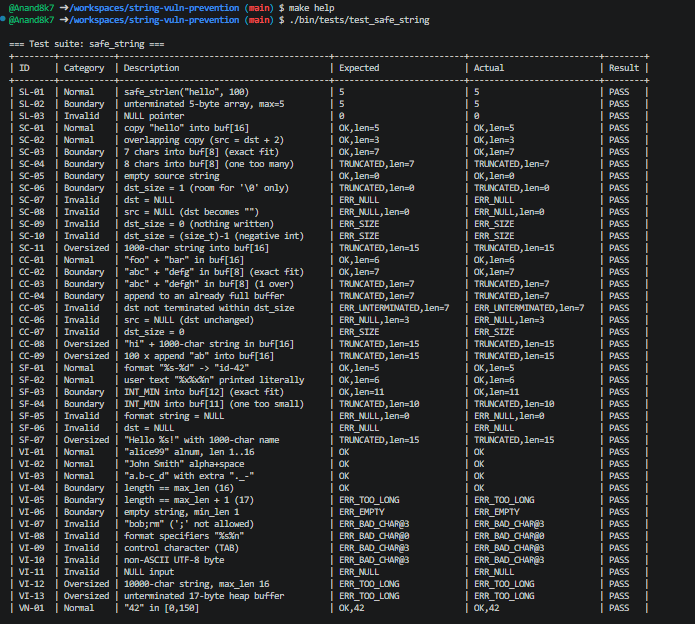
*Placeholder — capture with: `make test` (safe_string table)*

<!-- BEGIN OUTPUT 03_unit_input_handler.txt -->
*Real output — `docs/report/outputs/03_unit_input_handler.txt`*

```text
$ ./bin/tests/test_input_handler

=== Test suite: input_handler ===
+--------+-----------+------------------------------------------+--------------------------+--------------------------+--------+
| ID     | Category  | Description                              | Expected                 | Actual                   | Result |
+--------+-----------+------------------------------------------+--------------------------+--------------------------+--------+
| RL-01  | Normal    | "hello\n" into buf[16]                   | OK,len=5                 | OK,len=5                 | PASS   |
| RL-02  | Normal    | Windows line ending "hi\r\n"             | OK,len=2                 | OK,len=2                 | PASS   |
| RL-03  | Normal    | two lines read one after another         | OK,"two"                 | OK,"two"                 | PASS   |
| RL-04  | Boundary  | 7 chars + '\n' into buf[8] (fits)        | OK,len=7                 | OK,len=7                 | PASS   |
| RL-05  | Boundary  | ...next read gets the next line          | OK,"next"                | OK,"next"                | PASS   |
| RL-06  | Boundary  | 7 chars at EOF, no '\n', buf[8]          | OK,len=7                 | OK,len=7                 | PASS   |
| RL-07  | Boundary  | 8 chars into buf[8] (one too many)       | TOO_LONG,len=7           | TOO_LONG,len=7           | PASS   |
| RL-08  | Boundary  | ...leftover 'h' was drained              | OK,"next"                | OK,"next"                | PASS   |
| RL-09  | Invalid   | empty input (immediate EOF)              | EOF,len=0                | EOF,len=0                | PASS   |
| RL-10  | Invalid   | embedded NUL "ab\0cd\n" rejected         | ERR_NUL_BYTE,then "next" | ERR_NUL_BYTE,then "next" | PASS   |
| RL-11  | Invalid   | embedded NUL on last line (no '\n')      | ERR_NUL_BYTE,len=0       | ERR_NUL_BYTE,len=0       | PASS   |
| RL-12  | Invalid   | stream = NULL                            | ERR_NULL,len=0           | ERR_NULL,len=0           | PASS   |
| RL-13  | Invalid   | buf_size = 0 (nothing written)           | ERR_SIZE,len=0           | ERR_SIZE,len=0           | PASS   |
| RL-14  | Oversized | 5000-char line into buf[16]              | TOO_LONG,len=15          | TOO_LONG,len=15          | PASS   |
| RL-15  | Oversized | ...next line is read correctly           | OK,"ok"                  | OK,"ok"                  | PASS   |
| AR-01  | Normal    | argv[1] = "alice" into buf[16]           | OK,len=5                 | OK,len=5                 | PASS   |
| AR-02  | Boundary  | 7-char argument into buf[8]              | OK,len=7                 | OK,len=7                 | PASS   |
| AR-03  | Invalid   | argument index past argc                 | ERR_MISSING,len=0        | ERR_MISSING,len=0        | PASS   |
| AR-04  | Invalid   | negative argument index                  | ERR_MISSING,len=0        | ERR_MISSING,len=0        | PASS   |
| AR-05  | Oversized | 300-char argument into buf[16]           | TOO_LONG,len=15          | TOO_LONG,len=15          | PASS   |
| RF-01  | Normal    | 9-byte file into buf[32]                 | OK,len=9                 | OK,len=9                 | PASS   |
| RF-02  | Boundary  | 7-byte file into buf[8] (exact fit)      | OK,len=7                 | OK,len=7                 | PASS   |
| RF-03  | Boundary  | 8-byte file into buf[8] (one over)       | TOO_LONG,len=7           | TOO_LONG,len=7           | PASS   |
| RF-04  | Invalid   | file does not exist                      | ERR_IO,len=0             | ERR_IO,len=0             | PASS   |
| RF-05  | Oversized | 4096-byte file into buf[16]              | TOO_LONG,len=15          | TOO_LONG,len=15          | PASS   |
+--------+-----------+------------------------------------------+--------------------------+--------------------------+--------+
Summary [input_handler]: 25/25 passed, 0 failed
[exit code: 0]
```
<!-- END OUTPUT -->

**Figure 5 — input_handler unit tests**
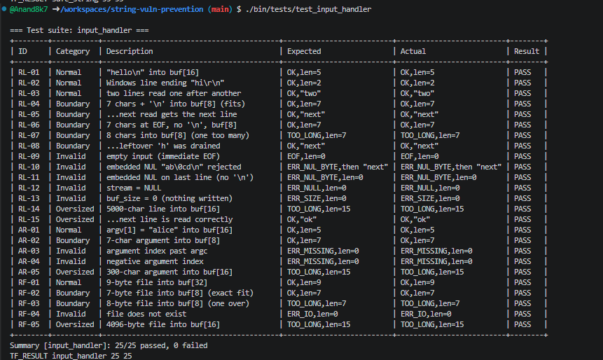
*Placeholder — capture with: `make test` (input_handler table)*

**Figure 6 — Valgrind on the unit tests (no ASan)**
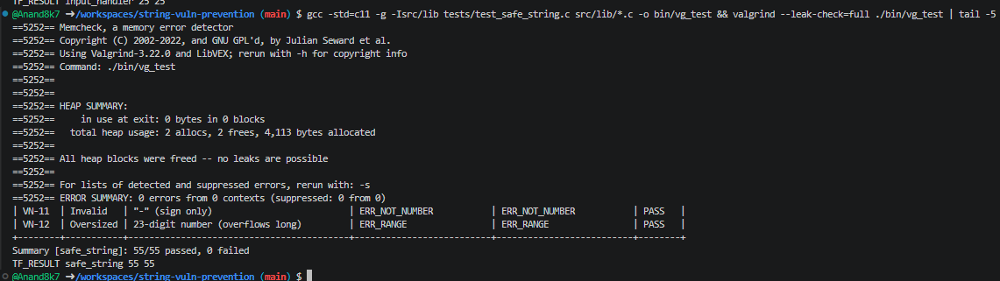
*Placeholder — capture with: `gcc -std=c11 -g -Isrc/lib tests/test_safe_string.c src/lib/*.c -o bin/vg_test && valgrind --leak-check=full ./bin/vg_test | tail -5`
(during development this reported `ERROR SUMMARY: 0 errors` and `All heap blocks were freed -- no leaks are possible` for both test programs)*

---

## 4. Q1 — Buffer overflow via `strcpy` / `strcat`

### 4.1 Aim and objective

**Aim:** Demonstrate how `strcpy` and `strcat` cause buffer overflows, and
prevent them with bounded copy/concatenation and length checks.

**Objectives:**

1. Write a program that copies a username into a fixed 16-byte field and
   builds a greeting and a home-directory path with `strcpy`/`strcat`.
2. Show the effects of an overflow: off-by-one, corruption of a neighbouring
   struct field, corruption of a neighbouring stack buffer, overwrite of the
   return address and a crash.
3. Rewrite the program with `input_from_arg`, `validate_input`,
   `safe_copy`, `safe_concat` and `safe_format`, rejecting any input that
   would be truncated.
4. Compare both versions with AddressSanitizer, Valgrind, Cppcheck and
   17 automated test cases.

### 4.2 Concept explanation

**How `strcpy` overflows.** `strcpy(dst, src)` copies bytes from `src` until
it has copied a `'\0'`. It is never told how big `dst` is. A 16-byte buffer
can hold at most **15** characters plus the terminator; a 16-character input
writes its `'\0'` into the 17th byte — an *off-by-one* (CWE-193). Longer input
keeps writing into whatever follows the buffer.

**What lies next to the buffer.** In the Q1 program the username is the first
field of a struct, directly followed by the `role` field:

```
struct account (32 bytes)                         stack frame of main()
┌──────────────────────┬──────────────────────┐   ┌─────────────────────┐
│ username[16]         │ role[16] = "guest"   │   │ acct, greeting[32], │
└──────────────────────┴──────────────────────┘   │ path[32], saved RBP,│
  16 x 'A' -> '\0' lands in role[0]  (role = "")  │ return address ...  │
  20 x 'A' -> "AAAA\0" lands in role (role="AAAA")└─────────────────────┘
```

Writing past `username` therefore silently *changes the user's role*; writing
further corrupts the other local buffers and finally the saved return
address, so the function "returns" to an address made of the input bytes.

**How `strcat` overflows.** `strcat(dst, src)` first scans `dst` for its
`'\0'` and then copies `src` there — again without knowing the size of `dst`.
Building `"/home/" + dept + "/" + username` in a 32-byte buffer overflows as
soon as the parts together exceed 31 characters, even if *each* part is valid
on its own.

**Prevention.**

| Technique | How it is applied |
|-----------|-------------------|
| Bounded input | `input_from_arg` copies `argv[i]` into a 16-byte buffer and reports `IN_TOO_LONG` |
| Whitelist validation | username: 1–15 of `[A-Za-z0-9._-]`; department: 1–15 letters |
| Bounded copy / concat | `safe_copy`, `safe_concat`, `safe_format` never write past the buffer and always terminate |
| Reject on truncation | any status other than `SS_OK` → `REJECTED`, exit code 2 |
| Output verification | buffers terminated; `role` still equals `"guest"` |
| Hardened build | `-D_FORTIFY_SOURCE=2`, `-fstack-protector-strong`, PIE, full RELRO |

### 4.3 Requirements / setup

| Item | Version used |
|------|--------------|
| OS | Ubuntu 24.04 (GitHub Codespaces), Linux 6.8 |
| Compiler | gcc 13.3.0 |
| Static analysis | Cppcheck 2.13.0 |
| Dynamic analysis | AddressSanitizer + UBSan (gcc), Valgrind 3.22.0 |
| Build | GNU Make 4.3 |

<!-- BEGIN OUTPUT 00_environment.txt -->
*Real output — `docs/report/outputs/00_environment.txt`*

```text
$ uname -sr
Linux 6.8.0-1070-azure
[exit code: 0]

$ gcc --version | head -n1
gcc (Ubuntu 13.3.0-6ubuntu2~24.04.1) 13.3.0
[exit code: 0]

$ cppcheck --version
Cppcheck 2.13.0
[exit code: 0]

$ valgrind --version
valgrind-3.22.0
[exit code: 0]

$ make --version | head -n1
GNU Make 4.3
[exit code: 0]
```
<!-- END OUTPUT -->

**Figure 1 — tool versions**
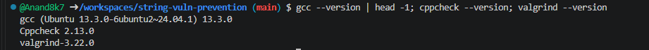
*Placeholder — capture with: `gcc --version | head -1; cppcheck --version; valgrind --version`*

Installation:

```bash
sudo apt-get update
sudo apt-get install -y build-essential cppcheck valgrind
git clone https://github.com/Anand8k7/string-vuln-prevention.git
cd string-vuln-prevention
```

### 4.4 Procedure / steps

```bash
# 1. Build the vulnerable, secure and ASan versions
make clean && make all asan

# 2. Helper variables used below
A15=$(printf 'A%.0s' {1..15})   # 15 x 'A'  (fits)
A16=$(printf 'A%.0s' {1..16})   # 16 x 'A'  (off-by-one)
A20=$(printf 'A%.0s' {1..20})   # 20 x 'A'  (overwrites role)

# 3. Run the vulnerable version
./bin/vulnerable/q1_overflow alice cse
./bin/vulnerable/q1_overflow $A16 cse
./bin/vulnerable/q1_overflow $A20 cse
./bin/vulnerable/q1_overflow abcdefghijklmno abcdefghijklmno
./bin/vulnerable/q1_overflow $(printf 'A%.0s' {1..100}) cse; echo "exit=$?"

# 4. Run the vulnerable version under AddressSanitizer and Valgrind
./bin/asan/vulnerable_q1_overflow abcdefghijklmno abcdefghijklmno
./bin/asan/vulnerable_q1_overflow $A20 cse
valgrind -q ./bin/vulnerable/q1_overflow $(printf 'A%.0s' {1..100}) cse

# 5. Run the secure version with the same inputs
./bin/secure/q1_overflow alice cse
./bin/secure/q1_overflow $A20 cse
./bin/secure/q1_overflow abcdefghijklmno abcdefghijklmno
./bin/secure/q1_overflow 'bob;ls' cse

# 6. Run all 17 test cases (vulnerable vs secure, 4 builds each)
bash tests/scenarios/q1_overflow.sh

# 7. Static analysis
cppcheck --enable=all --std=c11 --suppress=missingIncludeSystem -Isrc/lib src/vulnerable/q1_overflow.c
python3 analysis/banned_functions.py src/vulnerable/q1_overflow.c src/secure/q1_overflow.c
```

### 4.5 Program implementation

#### 4.5.1 Vulnerable version

Bugs are marked `[B1]`–`[B4]` in the comments.

<!-- BEGIN CODE src/vulnerable/q1_overflow.c c -->
*Source file — `src/vulnerable/q1_overflow.c`*

```c
/*
 * q1_overflow.c  (VULNERABLE VERSION)
 *
 * CYE551 Mini Project: Implementing Prevention Methods for String Vulnerabilities
 * Q1: Buffer overflow through strcpy / strcat
 *
 * !!! DELIBERATELY INSECURE TEACHING EXAMPLE - DO NOT REUSE THIS CODE !!!
 * It reads only local command-line input and contains no exploit payload.
 * It is compiled without stack protector / FORTIFY_SOURCE (see Makefile) so
 * that the memory corruption can be observed.
 *
 * Program: builds a simple user account record from two arguments
 *     ./q1_overflow <username> <department>
 * and prints a greeting and the user's home directory path.
 *
 * Bugs (all from functions that do not know the destination size):
 *   [B1] strcpy(acct.username, argv[1])       - CWE-120 / CWE-787
 *        username[16]: a 16-char name writes its '\0' into role[0]
 *        (off-by-one, CWE-193); longer names overwrite acct.role.
 *   [B2] strcat(greeting, acct.username)      - CWE-120
 *        greeting[32] can overflow when the name is long.
 *   [B3] strcpy/strcat chain into path[32]    - CWE-121 (stack overflow)
 *        "/home/" + dept + "/" + username has no length check at all.
 *   [B4] No validation of the input at all    - CWE-20
 */
#include <stdio.h>
#include <string.h>

#define NAME_SIZE 16
#define ROLE_SIZE 16
#define MSG_SIZE  32
#define PATH_SIZE 32

/* username is directly followed by role in memory, so writing past the end
 * of username silently changes role. */
struct account {
    char username[NAME_SIZE];
    char role[ROLE_SIZE];
};

int main(int argc, char *argv[])
{
    struct account acct;
    char greeting[MSG_SIZE];
    char path[PATH_SIZE];

    if (argc != 3) {
        fprintf(stderr, "Usage: %s <username> <department>\n", argv[0]);
        return 1;
    }

    /* Every new account starts as an unprivileged guest. */
    strcpy(acct.role, "guest");

    /* [B1] No length check: argv[1] can be any length. */
    strcpy(acct.username, argv[1]);

    /* [B2] Build "Welcome, <username>!" - no check that it fits in 32 bytes. */
    strcpy(greeting, "Welcome, ");
    strcat(greeting, acct.username);
    strcat(greeting, "!");

    /* [B3] Build "/home/<dept>/<username>" - no check that it fits either. */
    strcpy(path, "/home/");
    strcat(path, argv[2]);
    strcat(path, "/");
    strcat(path, acct.username);

    printf("%s\n", greeting);
    printf("Username : %s\n", acct.username);
    printf("Role     : %s\n", acct.role);
    printf("Home dir : %s\n", path);
    return 0;
}
```
<!-- END CODE -->

#### 4.5.2 Secure version

Each workflow step is marked `[1]`–`[6]`; each fix refers back to the bug it
removes.

<!-- BEGIN CODE src/secure/q1_overflow.c c -->
*Source file — `src/secure/q1_overflow.c`*

```c
/*
 * q1_overflow.c  (SECURE VERSION)
 *
 * CYE551 Mini Project: Implementing Prevention Methods for String Vulnerabilities
 * Q1: Buffer overflow through strcpy / strcat  ->  bounded copy/concat + checks
 *
 * Same program as src/vulnerable/q1_overflow.c:
 *     ./q1_overflow <username> <department>
 * but every step follows the project workflow:
 *
 *   [1] User Input          input_from_arg()   bounded copy of argv
 *   [2] Input Validation    validate_input()   whitelist + length rules
 *   [3] Length & Boundary   status codes checked; truncation = reject
 *   [4] Safe String Ops     safe_copy() / safe_concat() / safe_format()
 *   [5] Output Verification role unchanged, results terminated & in bounds
 *   [6] Result              print, or reject with a clear error message
 *
 * Fixes for the vulnerable version:
 *   [B1] strcpy(acct.username, argv[1]) -> input_from_arg + validate_input
 *        (1..15 chars) + safe_copy                       (CWE-120/787/193)
 *   [B2] strcat into greeting           -> safe_format, SS_TRUNCATED rejected
 *   [B3] strcpy/strcat chain into path  -> safe_copy + safe_concat, every
 *        status checked, SS_TRUNCATED rejected            (CWE-121)
 *   [B4] no validation                  -> whitelist validation (CWE-20)
 *
 * Exit codes: 0 = success, 1 = usage error, 2 = input rejected,
 *             3 = internal check failed (should never happen).
 */
#include "input_handler.h"
#include "safe_string.h"

#include <stdio.h>
#include <string.h>

#define NAME_SIZE 16
#define ROLE_SIZE 16
#define MSG_SIZE  32
#define PATH_SIZE 32

/* Allowed input. Max length is buffer size - 1 (room for '\0'). */
#define NAME_MAX_LEN   (NAME_SIZE - 1)
#define NAME_EXTRA     "._-"            /* plus letters and digits */
#define DEPT_MAX_LEN   15

struct account {
    char username[NAME_SIZE];
    char role[ROLE_SIZE];
};

/* Print a rejection message and return the "rejected" exit code. */
static int reject(const char *field, const char *reason)
{
    fprintf(stderr, "REJECTED: %s %s\n", field, reason);
    return 2;
}

/* Explain a validation failure in words. */
static int reject_validation(const char *field, val_status v, size_t pos,
                             size_t max_len)
{
    char msg[64];

    switch (v) {
    case VAL_ERR_TOO_LONG:
        (void)safe_format(msg, sizeof msg, "is too long (max %zu characters)",
                          max_len);
        break;
    case VAL_ERR_EMPTY:
        (void)safe_format(msg, sizeof msg, "must not be empty");
        break;
    case VAL_ERR_BAD_CHAR:
        (void)safe_format(msg, sizeof msg,
                          "contains a character that is not allowed "
                          "(position %zu)", pos);
        break;
    default:
        (void)safe_format(msg, sizeof msg, "is invalid (%s)",
                          val_status_str(v));
        break;
    }
    return reject(field, msg);
}

int main(int argc, char *argv[])
{
    struct account acct;
    char name_in[NAME_SIZE];       /* raw input, bounded */
    char dept_in[DEPT_MAX_LEN + 1];
    char greeting[MSG_SIZE];
    char path[PATH_SIZE];
    size_t bad_pos = 0;
    in_status in;
    val_status v;
    ss_status st;

    if (argc != 3) {
        fprintf(stderr, "Usage: %s <username> <department>\n",
                (argc > 0 && argv[0] != NULL) ? argv[0] : "q1_overflow");
        return 1;
    }

    /* The role is set first, exactly like the vulnerable version; step [5]
     * checks that nothing changed it. */
    st = safe_copy(acct.role, sizeof acct.role, "guest");
    if (st != SS_OK) {
        return 3;
    }

    /* ---- [1] User Input: bounded copies of argv ----------------------- */
    in = input_from_arg(argc, argv, 1, name_in, sizeof name_in);
    if (in == IN_TOO_LONG) {
        return reject("username", "is too long (max 15 characters)");
    }
    if (in != IN_OK) {
        return reject("username", in_status_str(in));
    }
    in = input_from_arg(argc, argv, 2, dept_in, sizeof dept_in);
    if (in == IN_TOO_LONG) {
        return reject("department", "is too long (max 15 characters)");
    }
    if (in != IN_OK) {
        return reject("department", in_status_str(in));
    }

    /* ---- [2] Input Validation: whitelist + length --------------------- */
    v = validate_input(name_in, 1, NAME_MAX_LEN, CHARSET_ALNUM, NAME_EXTRA,
                       &bad_pos);
    if (v != VAL_OK) {
        return reject_validation("username", v, bad_pos, NAME_MAX_LEN);
    }
    v = validate_input(dept_in, 1, DEPT_MAX_LEN, CHARSET_ALPHA, NULL,
                       &bad_pos);
    if (v != VAL_OK) {
        return reject_validation("department", v, bad_pos, DEPT_MAX_LEN);
    }

    /* ---- [3]+[4] Length checks + safe string operations --------------- */
    /* Every call reports SS_TRUNCATED instead of overflowing; any status
     * other than SS_OK means the result would not fit, so we reject. */
    st = safe_copy(acct.username, sizeof acct.username, name_in);
    if (st != SS_OK) {
        return reject("username", "does not fit in the account record");
    }

    st = safe_format(greeting, sizeof greeting, "Welcome, %s!", acct.username);
    if (st != SS_OK) {
        return reject("greeting", "would not fit in the message buffer");
    }

    st = safe_copy(path, sizeof path, "/home/");
    if (st == SS_OK) {
        st = safe_concat(path, sizeof path, dept_in);
    }
    if (st == SS_OK) {
        st = safe_concat(path, sizeof path, "/");
    }
    if (st == SS_OK) {
        st = safe_concat(path, sizeof path, acct.username);
    }
    if (st != SS_OK) {
        char msg[64];
        (void)safe_format(msg, sizeof msg,
                          "would exceed %d characters (%s)",
                          PATH_SIZE - 1, ss_status_str(st));
        return reject("home directory path", msg);
    }

    /* ---- [5] Output Verification -------------------------------------- */
    /* Defence in depth: confirm that no buffer is unterminated and that the
     * neighbouring field (role) was not modified. */
    if (safe_strlen(acct.username, sizeof acct.username) >= sizeof acct.username ||
        safe_strlen(greeting, sizeof greeting) >= sizeof greeting ||
        safe_strlen(path, sizeof path) >= sizeof path ||
        safe_strlen(acct.role, sizeof acct.role) >= sizeof acct.role ||
        strcmp(acct.role, "guest") != 0) {
        fprintf(stderr, "INTERNAL ERROR: output verification failed\n");
        return 3;
    }

    /* ---- [6] Result --------------------------------------------------- */
    /* Fixed format strings: user data is only ever passed as "%s" args. */
    printf("%s\n", greeting);
    printf("Username : %s\n", acct.username);
    printf("Role     : %s\n", acct.role);
    printf("Home dir : %s\n", path);
    return 0;
}
```
<!-- END CODE -->

### 4.6 Expected output and execution

#### Vulnerable version

<!-- BEGIN OUTPUT q1_01_vuln_runs.txt -->
*Real output — `docs/report/outputs/q1_01_vuln_runs.txt`*

```text
$ ./bin/vulnerable/q1_overflow alice cse
Welcome, alice!
Username : alice
Role     : guest
Home dir : /home/cse/alice
[exit code: 0]

$ ./bin/vulnerable/q1_overflow $A15 cse
Welcome, AAAAAAAAAAAAAAA!
Username : AAAAAAAAAAAAAAA
Role     : guest
Home dir : /home/cse/AAAAAAAAAAAAAAA
[exit code: 0]

$ ./bin/vulnerable/q1_overflow $A16 cse
Welcome, AAAAAAAAAAAAAAAA!
Username : AAAAAAAAAAAAAAAA
Role     : 
Home dir : /home/cse/AAAAAAAAAAAAAAAA
[exit code: 0]

$ ./bin/vulnerable/q1_overflow $A20 cse
Welcome, AAAAAAAAAAAAAAAAAAAA!
Username : AAAAAAAAAAAAAAAAAAAA
Role     : AAAA
Home dir : /home/cse/AAAAAAAAAAAAAAAAAAAA
[exit code: 0]

$ ./bin/vulnerable/q1_overflow abcdefghijklmno abcdefghijklmno
klmno
Username : abcdefghijklmno
Role     : guest
Home dir : /home/abcdefghijklmno/abcdefghijklmno
[exit code: 0]

$ ./bin/vulnerable/q1_overflow $(printf 'A%.0s' {1..100}) cse
[exit code: 139]
```
<!-- END OUTPUT -->

What the output shows:

| Input | Effect |
|-------|--------|
| `alice cse`, 15 × `A` | correct output |
| 16 × `A` | `Role :` is **empty** — the terminating `'\0'` was written into `role[0]` (off-by-one) |
| 20 × `A` | `Role : AAAA` — the last four characters overwrote the role |
| user 15 + dept 15 | first line is `klmno` instead of the greeting — `path[32]` overflowed into `greeting` |
| 100 × `A` | exit code 139 = **SIGSEGV** (crash) |

**Figure 7 — vulnerable Q1: normal input vs overflow**
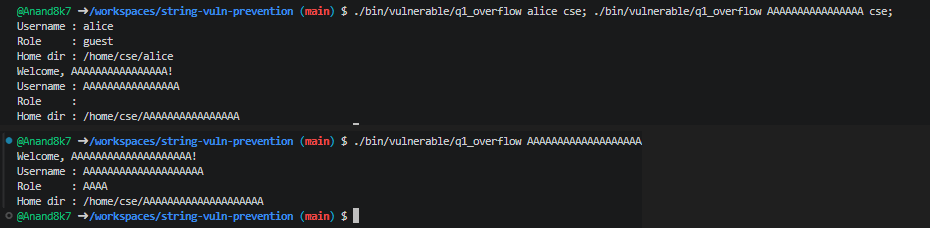
*Placeholder — capture with: `./bin/vulnerable/q1_overflow alice cse; ./bin/vulnerable/q1_overflow AAAAAAAAAAAAAAAA cse; ./bin/vulnerable/q1_overflow AAAAAAAAAAAAAAAAAAAA cse`*

**Figure 8 — vulnerable Q1: crash**
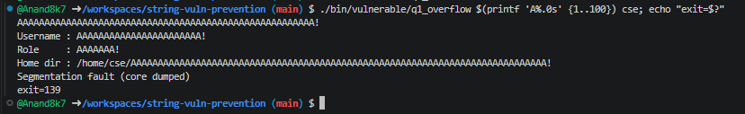
*Placeholder — capture with: `./bin/vulnerable/q1_overflow $(printf 'A%.0s' {1..100}) cse; echo "exit=$?"`*

#### Secure version

<!-- BEGIN OUTPUT q1_05_secure_runs.txt -->
*Real output — `docs/report/outputs/q1_05_secure_runs.txt`*

```text
$ ./bin/secure/q1_overflow alice cse
Welcome, alice!
Username : alice
Role     : guest
Home dir : /home/cse/alice
[exit code: 0]

$ ./bin/secure/q1_overflow $A15 cse
Welcome, AAAAAAAAAAAAAAA!
Username : AAAAAAAAAAAAAAA
Role     : guest
Home dir : /home/cse/AAAAAAAAAAAAAAA
[exit code: 0]

$ ./bin/secure/q1_overflow $A16 cse
REJECTED: username is too long (max 15 characters)
[exit code: 2]

$ ./bin/secure/q1_overflow $A20 cse
REJECTED: username is too long (max 15 characters)
[exit code: 2]

$ ./bin/secure/q1_overflow abcdefghijklmno abcdefghijklmno
REJECTED: home directory path would exceed 31 characters (SS_TRUNCATED)
[exit code: 2]

$ ./bin/secure/q1_overflow 'bob;ls' cse
REJECTED: username contains a character that is not allowed (position 3)
[exit code: 2]

$ ./bin/secure/q1_overflow '' cse
REJECTED: username must not be empty
[exit code: 2]

$ ./bin/secure/q1_overflow $(printf 'A%.0s' {1..100}) cse
REJECTED: username is too long (max 15 characters)
[exit code: 2]
```
<!-- END OUTPUT -->

Every bad input is rejected with a clear reason and exit code 2. The
`abcdefghijklmno abcdefghijklmno` case is important: both inputs are valid on
their own, but the combined path would need 37 characters, so `safe_concat`
returns `SS_TRUNCATED` and the program refuses to continue.

**Figure 11 — secure Q1 rejects bad input**
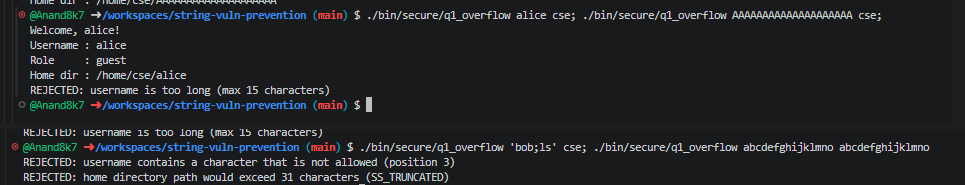
*Placeholder — capture with: `./bin/secure/q1_overflow alice cse; ./bin/secure/q1_overflow AAAAAAAAAAAAAAAAAAAA cse; ./bin/secure/q1_overflow 'bob;ls' cse; ./bin/secure/q1_overflow abcdefghijklmno abcdefghijklmno`*

### 4.7 Security analysis

| Bug | Code (vulnerable) | CWE | Impact observed | Fix (secure) |
|-----|-------------------|-----|-----------------|--------------|
| B1 | `strcpy(acct.username, argv[1])` | CWE-120 Buffer Copy without Checking Size of Input; CWE-787 Out-of-bounds Write; CWE-193 Off-by-one Error | `role` wiped (16 chars) or overwritten (20 chars); privilege-relevant data changed by input | `input_from_arg` + `validate_input` (1–15 chars) + `safe_copy`, reject unless `SS_OK` |
| B2 | `strcat(greeting, acct.username)` | CWE-120, CWE-787 | stack-buffer-overflow on `greeting` (24+ chars) | `safe_format(greeting, sizeof greeting, "Welcome, %s!", ...)`, reject on `SS_TRUNCATED` |
| B3 | `strcpy/strcat` chain into `path[32]` | CWE-121 Stack-based Buffer Overflow | `greeting` corrupted; with 100 chars the return address became `0x4141414141414141` and the program crashed | `safe_copy` + `safe_concat`, every status checked, reject on `SS_TRUNCATED` |
| B4 | no validation of `argv` | CWE-20 Improper Input Validation | `bob;ls`, empty names, spaces all accepted | whitelist `[A-Za-z0-9._-]` (username), letters only (department) |

Relevant SEI CERT C rules: **STR31-C** (guarantee that storage for strings
has sufficient space for character data and the null terminator), **STR32-C**
(do not pass a non-null-terminated character sequence to a library function
that expects a string), **STR07-C** (use bounds-checking interfaces for
string manipulation).

**Why the return-address overwrite matters.** Valgrind shows the CPU jumping
to `0x4141414141414141` — the bytes of `"AAAAAAAA"`. The input decided where
the program continued executing. Our test only used the letter `A` and the
program crashed, but this is exactly the mechanism that classic stack-smashing
attacks rely on. The stack protector (`-fstack-protector-strong`) in the
secure build would detect such an overwrite, but the real fix is that the
secure code never writes out of bounds.

### 4.8 Test cases

The scenario script runs each case on **four** builds: vulnerable,
vulnerable + ASan, secure, secure + ASan. A case passes when the secure build
gives the expected result (ACCEPT / REJECT / USAGE) **and** the secure ASan
build reports no error. The vulnerable columns record what actually happened.

| ID | Category | Input | Vulnerable (observed) | Secure (expected = observed) |
|----|----------|-------|-----------------------|------------------------------|
| Q1-01 | Normal | `alice cse` | OK | ACCEPT |
| Q1-02 | Normal | `j.doe-99 ise` | OK | ACCEPT |
| Q1-03 | Boundary | username 15 chars | OK | ACCEPT |
| Q1-04 | Boundary | username 16 chars | role wiped `""` | REJECT – too long |
| Q1-05 | Boundary | path exactly 31 chars | OK | ACCEPT |
| Q1-06 | Boundary | path 32 chars (1 over) | greeting corrupted; ASan stack-buffer-overflow | REJECT – path too long |
| Q1-07 | Boundary | user 15 + dept 15 | greeting corrupted; ASan stack-buffer-overflow | REJECT – path too long |
| Q1-08 | Invalid | empty username | accepted | REJECT – empty |
| Q1-09 | Invalid | `bob;ls` | accepted | REJECT – bad char |
| Q1-10 | Invalid | `bob smith` | accepted | REJECT – bad char |
| Q1-11 | Invalid | department `cse1` | accepted | REJECT – bad char |
| Q1-12 | Invalid | missing argument | usage error | USAGE |
| Q1-13 | Oversized | 20 × `A` | role overwritten `AAAA` (ASan: not detected) | REJECT – too long |
| Q1-14 | Oversized | 24 × `A` | role overwritten; ASan stack-buffer-overflow | REJECT – too long |
| Q1-15 | Oversized | 100 × `A` | CRASH (SIGSEGV) | REJECT – too long |
| Q1-16 | Oversized | 5000 × `A` | CRASH (SIGSEGV) | REJECT – too long |
| Q1-17 | Oversized | department 100 × `A` | CRASH (SIGSEGV) | REJECT – too long |

Full automated run:

<!-- BEGIN OUTPUT q1_07_tests.txt -->
*Real output — `docs/report/outputs/q1_07_tests.txt`*

```text
$ bash tests/scenarios/q1_overflow.sh | grep -v '^TF_RESULT'

=== Scenario suite: q1_overflow (vulnerable vs secure) ===
+-------+-----------+------------------------------+--------------------------+--------------------------------+--------+------------------------------+-------+--------+
| ID    | Category  | Input                        | Vulnerable (plain)       | Vulnerable (ASan build)        | Expect | Secure result                | S+ASn | Result |
+-------+-----------+------------------------------+--------------------------+--------------------------------+--------+------------------------------+-------+--------+
| Q1-01 | Normal    | alice cse                    | OK (no visible effect)   | OK (no visible effect)         | ACCEPT | ACCEPT                       | clean | PASS   |
| Q1-02 | Normal    | j.doe-99 ise (allowed ._-)   | OK (no visible effect)   | OK (no visible effect)         | ACCEPT | ACCEPT                       | clean | PASS   |
| Q1-03 | Boundary  | username 15 chars (max)      | OK (no visible effect)   | OK (no visible effect)         | ACCEPT | ACCEPT                       | clean | PASS   |
| Q1-04 | Boundary  | username 16 chars (max+1)    | role wiped ("")          | NOT DETECTED: role wiped ("")  | REJECT | REJECT: username too long    | clean | PASS   |
| Q1-05 | Boundary  | path = 31 chars (exact fit)  | OK (no visible effect)   | OK (no visible effect)         | ACCEPT | ACCEPT                       | clean | PASS   |
| Q1-06 | Boundary  | path = 32 chars (1 over)     | greeting corrupted       | ASan: stack-buffer-overflow    | REJECT | REJECT: path too long        | clean | PASS   |
| Q1-07 | Boundary  | user 15 + dept 15 (path 37)  | greeting corrupted       | ASan: stack-buffer-overflow    | REJECT | REJECT: path too long        | clean | PASS   |
| Q1-08 | Invalid   | empty username               | OK (no visible effect)   | OK (no visible effect)         | REJECT | REJECT: username empty       | clean | PASS   |
| Q1-09 | Invalid   | username "bob;ls"            | OK (no visible effect)   | OK (no visible effect)         | REJECT | REJECT: username bad char    | clean | PASS   |
| Q1-10 | Invalid   | username with space          | OK (no visible effect)   | OK (no visible effect)         | REJECT | REJECT: username bad char    | clean | PASS   |
| Q1-11 | Invalid   | department "cse1" (digit)    | OK (no visible effect)   | OK (no visible effect)         | REJECT | REJECT: department bad char  | clean | PASS   |
| Q1-12 | Invalid   | missing department argument  | usage error              | usage error                    | USAGE  | USAGE                        | clean | PASS   |
| Q1-13 | Oversized | username 20 x 'A'            | role overwritten "AAAA"  | NOT DETECTED: role overwritten | REJECT | REJECT: username too long    | clean | PASS   |
| Q1-14 | Oversized | username 24 x 'A'            | role overwritten "AAAAAA | ASan: stack-buffer-overflow    | REJECT | REJECT: username too long    | clean | PASS   |
| Q1-15 | Oversized | username 100 x 'A'           | CRASH (SIGSEGV)          | ASan: stack-buffer-overflow    | REJECT | REJECT: username too long    | clean | PASS   |
| Q1-16 | Oversized | username 5000 x 'A'          | CRASH (SIGSEGV)          | ASan: stack-buffer-overflow    | REJECT | REJECT: username too long    | clean | PASS   |
| Q1-17 | Oversized | department 100 x 'A'         | CRASH (SIGSEGV)          | ASan: stack-buffer-overflow    | REJECT | REJECT: department too long  | clean | PASS   |
+-------+-----------+------------------------------+--------------------------+--------------------------------+--------+------------------------------+-------+--------+
Summary [q1_overflow]: 17/17 passed, 0 failed
Full program output for every run: analysis/logs/scenarios/q1_overflow/
[exit code: 0]
```
<!-- END OUTPUT -->

**Negative control.** To prove the suite can fail, the vulnerable binary was
put in place of the secure one:

<!-- BEGIN OUTPUT q1_09_negative_control.txt -->
*Real output — `docs/report/outputs/q1_09_negative_control.txt`*

```text
$ bash tests/scenarios/q1_overflow.sh | grep '^Summary'
Summary [q1_overflow]: 5/17 passed, 12 failed
[exit code: 0]
```
<!-- END OUTPUT -->

**Figure 12 — Q1 test table**
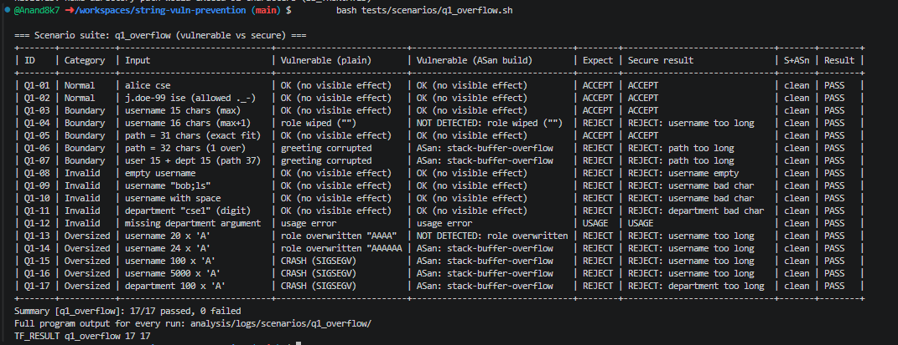
*Placeholder — capture with: `bash tests/scenarios/q1_overflow.sh` (zoom out; the table is about 170 characters wide)*

### 4.9 Observations and results

#### AddressSanitizer — before (vulnerable)

When `path[32]` overflows, ASan stops the program and names the variable,
the source line and the size of the write:

<!-- BEGIN OUTPUT q1_02_asan_path_overflow.txt lines=1-20 -->
*Real output — `docs/report/outputs/q1_02_asan_path_overflow.txt`*

```text
$ ./bin/asan/vulnerable_q1_overflow abcdefghijklmno abcdefghijklmno
=================================================================
==62510==ERROR: AddressSanitizer: stack-buffer-overflow on address 0x74daa6b000c0 at pc 0x74daa96b9260 bp 0x7ffd70f11ed0 sp 0x7ffd70f11678
WRITE of size 16 at 0x74daa6b000c0 thread T0
    #0 0x74daa96b925f in strcat ../../../../src/libsanitizer/asan/asan_interceptors.cpp:515
    #1 0x6405a8bcf69a in main src/vulnerable/q1_overflow.c:67
    #2 0x74daa8dc41c9 in __libc_start_call_main ../sysdeps/nptl/libc_start_call_main.h:58
    #3 0x74daa8dc428a in __libc_start_main_impl ../csu/libc-start.c:360
    #4 0x6405a8bcf284 in _start (bin/asan/vulnerable_q1_overflow+0x2284) (BuildId: 4ef7c6f699d2e443af6627ffb340ab9ec02e3f61)

Address 0x74daa6b000c0 is located in stack of thread T0 at offset 192 in frame
    #0 0x6405a8bcf358 in main src/vulnerable/q1_overflow.c:42

  This frame has 3 object(s):
    [32, 64) 'acct' (line 43)
    [96, 128) 'greeting' (line 44)
    [160, 192) 'path' (line 45) <== Memory access at offset 192 overflows this variable
HINT: this may be a false positive if your program uses some custom stack unwind mechanism, swapcontext or vfork
      (longjmp and C++ exceptions *are* supported)
SUMMARY: AddressSanitizer: stack-buffer-overflow ../../../../src/libsanitizer/asan/asan_interceptors.cpp:515 in strcat
... (33 more lines in docs/report/outputs/q1_02_asan_path_overflow.txt)
```
<!-- END OUTPUT -->

**Figure 9 — ASan stack-buffer-overflow (Q1)**
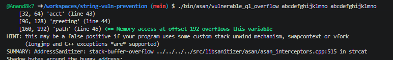
*Placeholder — capture with: `./bin/asan/vulnerable_q1_overflow abcdefghijklmno abcdefghijklmno`*

**ASan limitation — overflow inside a struct.** With 20 characters the
username overflows into `role`, which is part of the *same* object, so ASan
has no red zone between them and reports nothing:

<!-- BEGIN OUTPUT q1_03_asan_intra_struct.txt -->
*Real output — `docs/report/outputs/q1_03_asan_intra_struct.txt`*

```text
$ ./bin/asan/vulnerable_q1_overflow $A20 cse
Welcome, AAAAAAAAAAAAAAAAAAAA!
Username : AAAAAAAAAAAAAAAAAAAA
Role     : AAAA
Home dir : /home/cse/AAAAAAAAAAAAAAAAAAAA
[exit code: 0]
```
<!-- END OUTPUT -->

**Figure 10 — ASan misses the intra-struct overflow**
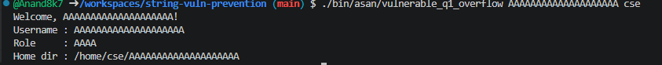
*Placeholder — capture with: `./bin/asan/vulnerable_q1_overflow AAAAAAAAAAAAAAAAAAAA cse`*

#### Valgrind — before (vulnerable)

Valgrind does not track individual stack arrays, so it did not report the
`path` or `role` overflows (0 errors, see Section 6). With 100 characters it
reports overlapping `strcat` arguments and then the jump to the overwritten
return address:

<!-- BEGIN OUTPUT q1_04_valgrind_ret_overwrite.txt -->
*Real output — `docs/report/outputs/q1_04_valgrind_ret_overwrite.txt`*

```text
$ valgrind -q ./bin/vulnerable/q1_overflow $(printf 'A%.0s' {1..100}) cse 2>&1 | head -n 18
==62516== Source and destination overlap in strcat(0x1ffeffec50, 0x1ffeffec70)
==62516==    at 0x484EFE3: strcat (in /usr/libexec/valgrind/vgpreload_memcheck-amd64-linux.so)
==62516==    by 0x109288: main (q1_overflow.c:60)
==62516== 
==62516== Source and destination overlap in strcat(0x1ffeffec30, 0x1ffeffec70)
==62516==    at 0x484EFE3: strcat (in /usr/libexec/valgrind/vgpreload_memcheck-amd64-linux.so)
==62516==    by 0x1092FC: main (q1_overflow.c:67)
==62516== 
==62516== Jump to the invalid address stated on the next line
==62516==    at 0x4141414141414141: ???
==62516==    by 0x4141414141414140: ???
==62516==    by 0x4141414141414140: ???
==62516==    by 0x4141414141414140: ???
==62516==    by 0x4100214141414140: ???
==62516==    by 0x4141414141414140: ???
==62516==    by 0x4141414141414140: ???
==62516==    by 0x41414140: ???
==62516==  Address 0x4141414141414141 is not stack'd, malloc'd or (recently) free'd
[exit code: 0]
```
<!-- END OUTPUT -->

**Figure 21 — Valgrind: return address overwritten**
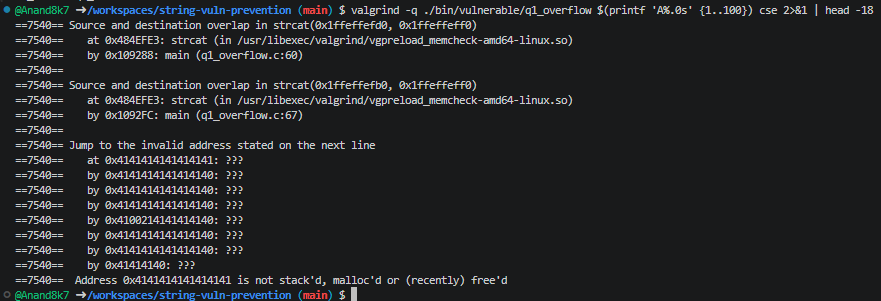
*Placeholder — capture with: `valgrind -q ./bin/vulnerable/q1_overflow $(printf 'A%.0s' {1..100}) cse 2>&1 | head -18`*

#### FORTIFY_SOURCE

Compiling the **same vulnerable code** with `-O2 -D_FORTIFY_SOURCE=2` makes
glibc check `strcpy` against the known size of `acct.username`. It stops the
off-by-one case that ASan missed in the intra-struct form:

<!-- BEGIN OUTPUT q1_08_fortify.txt -->
*Real output — `docs/report/outputs/q1_08_fortify.txt`*

```text
$ gcc -std=c11 -O2 -D_FORTIFY_SOURCE=2 src/vulnerable/q1_overflow.c -o bin/q1_overflow_fortify
[exit code: 0]

$ ./bin/q1_overflow_fortify $A16 cse
*** buffer overflow detected ***: terminated
[exit code: 134]
```
<!-- END OUTPUT -->

#### After (secure)

The secure build under ASan with the worst inputs:

<!-- BEGIN OUTPUT q1_06_asan_secure.txt -->
*Real output — `docs/report/outputs/q1_06_asan_secure.txt`*

```text
$ ./bin/asan/secure_q1_overflow abcdefghijklmno abcdefghijklmno
REJECTED: home directory path would exceed 31 characters (SS_TRUNCATED)
[exit code: 2]

$ ./bin/asan/secure_q1_overflow $(printf 'A%.0s' {1..5000}) cse
REJECTED: username is too long (max 15 characters)
[exit code: 2]
```
<!-- END OUTPUT -->

#### Before vs after summary

| Check | Vulnerable Q1 | Secure Q1 |
|-------|---------------|-----------|
| gcc `-Wall -Wextra -Wformat=2 -O2` | 0 warnings (gcc cannot know the length of `argv`) | 0 warnings, builds with `-Werror` |
| Cppcheck `--enable=all` | 1 style note (`argv` could be const); **the overflows are not reported** | 0 findings |
| Banned-API scan | 9 findings (4 × `strcpy`, 5 × `strcat`) | 0 findings |
| ASan (4 attack inputs, Section 6) | 2 × stack-buffer-overflow; intra-struct overflow **missed** | no errors |
| Valgrind (same inputs) | SIGSEGV with jump to `0x4141414141414141` (100 chars); other overflows not seen | 0 errors |
| FORTIFY_SOURCE=2 | `*** buffer overflow detected ***` (16 chars) | n/a (no overflow) |
| Test cases | 12 of 17 cases show a defect | 17 / 17 PASS |

### 4.10 Learning outcomes

1. `strcpy`/`strcat` trust the source length; the destination size must be
   enforced by the programmer — a 16-byte buffer holds only 15 characters.
2. An overflow does not always crash. The most dangerous result in this
   project was the *silent* one: the `role` field changed from `guest` to
   `AAAA` and the program carried on normally.
3. Each part of a string can be valid while the combination is too long, so
   the length check must happen at every concatenation (`safe_concat`
   returning `SS_TRUNCATED`), not only at input.
4. Truncating silently is not a fix; reporting truncation and rejecting the
   input keeps the program's data correct.
5. No single tool is enough: ASan missed the intra-object overflow, Valgrind
   missed every stack overflow until the crash, and Cppcheck missed
   `strcpy`/`strcat` completely. Bounded APIs plus validation plus tests
   catch what the tools miss.

---

## 5. Q2 — Improper input validation and unsafe formatting

### 5.1 Aim and objective

**Aim:** Demonstrate the risks of `scanf("%s")`, unchecked `scanf("%d")`,
`sprintf` and `printf(user_input)`, and prevent them with `fgets`-based input,
whitelist validation, `snprintf` and fixed format strings.

**Objectives:**

1. Write a feedback-form program that reads a name, an age and a message
   from standard input using the unsafe functions.
2. Show overflow, field desynchronisation, accepted invalid values, integer
   overflow, information leakage and crashes caused by format strings.
3. Rewrite it with `input_read_line`, `validate_input`, `validate_integer`,
   `safe_format` and fixed format strings.
4. Compare both versions with compiler warnings, Cppcheck, ASan, Valgrind and
   26 automated test cases.

### 5.2 Concept explanation

**`scanf("%s")`** reads a whitespace-delimited word of *any* length into the
buffer — it has the same problem as `gets` (CWE-242). It also stops at the
first space, so `John Smith` is split into two fields.

**Unchecked `scanf("%d")`.** `scanf` returns the number of items converted.
If the user types `abc`, it returns 0, leaves `age` unchanged (here
uninitialised, CWE-457) and leaves `abc` in the input stream, where the next
`scanf` picks it up as the message. Out-of-range numbers are not detected,
and a number too large for `int` silently becomes a different value.

**`sprintf`** writes the formatted result without any size limit (CWE-787).
`snprintf`/`vsnprintf` take the buffer size and return the length the full
result *would* have had, which makes truncation detectable.

**Format-string bugs (CWE-134).** In `printf(msg)` the user's text is the
format. Each `%` conversion makes `printf` fetch the next "argument" from
registers and the stack — arguments that were never passed:

| User text | What `printf(msg)` does |
|-----------|--------------------------|
| `%p.%p.%p.%p` | prints four values from registers/stack (information leak) |
| `%27$lx` | prints the 27th argument slot directly — in this build, the stack slot holding `secret_token` |
| `%s%s%s…` | treats stack values as pointers and reads from them → crash |
| `50%off` | `%o` consumes a stack value and prints it in octal — even innocent text is corrupted |
| `%n` | would **write** to memory (not used in this project) |

The fix is simple and complete: user text must only ever be an *argument*,
never the format — `printf("%s", msg)`. In the secure program `%` is
deliberately **allowed** in messages (for text like "50% off") to show that
the fixed format string alone neutralises `%p`, `%27$lx` and `%s`.

### 5.3 Requirements / setup

Same environment as Q1 (Section 4.3): Ubuntu 24.04, gcc 13.3.0,
Cppcheck 2.13.0, Valgrind 3.22.0, GNU Make 4.3.

### 5.4 Procedure / steps

```bash
# 1. Build (the vulnerable build already prints gcc warnings for Q2)
make clean && make all asan

# 2. Vulnerable version - format strings (input: name, age, message)
printf 'alice\n21\nhello\n'           | ./bin/vulnerable/q2_format
printf 'alice\n21\n%%p.%%p.%%p.%%p\n'     | ./bin/vulnerable/q2_format
printf 'alice\n21\n%%27$lx\n'          | ./bin/vulnerable/q2_format
printf 'alice\n21\n50%%off\n'          | ./bin/vulnerable/q2_format
printf 'alice\n21\n%%s%%s%%s%%s%%s%%s%%s%%s\n' | ./bin/vulnerable/q2_format; echo "exit=$?"

# 3. Vulnerable version - validation
printf 'alice\nabc\nhello\n'          | ./bin/vulnerable/q2_format
printf 'John Smith\n21\nhello\n'      | ./bin/vulnerable/q2_format
printf 'alice\n-5\nhello\n'           | ./bin/vulnerable/q2_format
printf 'alice\n99999999999999999999\nhello\n' | ./bin/vulnerable/q2_format

# 4. ASan: record[64] overflow through sprintf
printf 'alice\n21\n%s\n' $(printf 'B%.0s' {1..60}) | ./bin/asan/vulnerable_q2_format

# 5. Secure version with the same inputs (replace bin/vulnerable with bin/secure)
printf 'alice\n21\n%%p.%%p.%%p.%%p\n'     | ./bin/secure/q2_format
printf 'alice\nabc\nhello\n'          | ./bin/secure/q2_format

# 6. All 26 test cases
bash tests/scenarios/q2_format.sh
```

(In `printf` the sequence `%%` produces a single `%`, so the program receives
`%p.%p.%p.%p`.)

### 5.5 Program implementation

#### 5.5.1 Vulnerable version

<!-- BEGIN CODE src/vulnerable/q2_format.c c -->
*Source file — `src/vulnerable/q2_format.c`*

```c
/*
 * q2_format.c  (VULNERABLE VERSION)
 *
 * CYE551 Mini Project: Implementing Prevention Methods for String Vulnerabilities
 * Q2: Improper input validation + unsafe formatting
 *     (scanf("%s"), scanf("%d") unchecked, sprintf, printf(user_input))
 *
 * !!! DELIBERATELY INSECURE TEACHING EXAMPLE - DO NOT REUSE THIS CODE !!!
 * It reads only local keyboard / redirected input and contains no exploit
 * payload. It is compiled without stack protector / FORTIFY_SOURCE (see
 * Makefile) so the effects can be observed.
 *
 * Program: a small feedback form. Reads three values from standard input
 *     Name, Age, Message   (one per line)
 * echoes the message back and stores a one-line record.
 *
 * Bugs:
 *   [B1] scanf("%s", name)   - no field width: unbounded write into
 *        name[16] (CWE-120, CWE-242). It also stops at the first space, so
 *        "John Smith" is split and "Smith" is read as the next field.
 *   [B2] scanf("%d", &age)   - return value ignored (CWE-252) and no range
 *        check (CWE-20). On non-numeric input `age` is used uninitialised
 *        (CWE-457) and the text stays in stdin for the next scanf.
 *   [B3] sprintf(record, ...) - no bound on record[64] (CWE-120, CWE-787).
 *   [B4] printf(msg)          - user input used as the FORMAT STRING
 *        (CWE-134): "%p" / "%lx" print stack contents (information leak),
 *        "%s%s%s..." dereferences random values and crashes.
 *   The simulated secret below stands in for any sensitive value that
 *   lives on the stack (session key, password hash, ...).
 */
#include <stdio.h>

#define NAME_SIZE   16
#define MSG_SIZE    64
#define RECORD_SIZE 64

int main(void)
{
    /* Simulated sensitive value kept in a local variable. */
    volatile unsigned long secret_token = 0x5EC12E7AB1EUL;
    char name[NAME_SIZE];
    char msg[MSG_SIZE];
    char record[RECORD_SIZE];
    int age;                      /* [B2] not initialised */

    printf("Name: ");
    scanf("%s", name);            /* [B1] unbounded %s */

    printf("Age: ");
    scanf("%d", &age);            /* [B2] result not checked, no range */

    printf("Message: ");
    scanf("%s", msg);             /* [B1] unbounded %s again */
    printf("\n");

    /* [B4] The user's message is passed as the format string. */
    printf("Your message: ");
    printf(msg);
    printf("\n");

    /* [B3] No bound on the size of the record. */
    sprintf(record, "name=%s age=%d msg=%s", name, age, msg);
    printf("Saved record: %s\n", record);

    (void)secret_token;
    return 0;
}
```
<!-- END CODE -->

#### 5.5.2 Secure version

<!-- BEGIN CODE src/secure/q2_format.c c -->
*Source file — `src/secure/q2_format.c`*

```c
/*
 * q2_format.c  (SECURE VERSION)
 *
 * CYE551 Mini Project: Implementing Prevention Methods for String Vulnerabilities
 * Q2: Improper input validation + unsafe formatting
 *     -> fgets, whitelist validation, strict number parsing, snprintf,
 *        fixed format strings
 *
 * Same feedback form as src/vulnerable/q2_format.c (Name, Age, Message on
 * standard input, one per line) but following the project workflow:
 *
 *   [1] User Input          input_read_line()  fgets-based, bounded, drains
 *                                              over-long lines, rejects NUL
 *   [2] Input Validation    validate_input() / validate_integer()
 *   [3] Length & Boundary   IN_TOO_LONG / SS_TRUNCATED => reject
 *   [4] Safe String Ops     safe_format() (vsnprintf) for the record
 *   [5] Output Verification record terminated and has the expected length
 *   [6] Result              printed ONLY through fixed format strings
 *
 * Fixes for the vulnerable version:
 *   [B1] scanf("%s")          -> input_read_line (fgets) + length limit;
 *                               whole line is read, so "John Smith" works
 *   [B2] scanf("%d") unchecked-> validate_integer: digits only, 1..120,
 *                               overflow detected, every result checked
 *   [B3] sprintf(record, ...) -> safe_format, SS_TRUNCATED rejected
 *   [B4] printf(msg)          -> printf("%s", msg): user text is DATA, never
 *                               a format. '%' is deliberately ALLOWED in the
 *                               message ("50% off") to show that the fixed
 *                               format string alone neutralises "%p", "%n".
 *
 * Exit codes: 0 = success, 2 = input rejected, 3 = internal check failed.
 */
#include "input_handler.h"
#include "safe_string.h"

#include <stdio.h>
#include <string.h>

#define NAME_SIZE   16
#define MSG_SIZE    41          /* message: at most 40 characters */
#define RECORD_SIZE 64
#define AGE_SIZE    8           /* "120" fits easily; longer = invalid */

#define NAME_MAX_LEN (NAME_SIZE - 1)
#define MSG_MAX_LEN  (MSG_SIZE - 1)
#define AGE_MIN      1
#define AGE_MAX      120

/* Whitelists (letters/digits/space come from the CHARSET_* flags). */
#define NAME_EXTRA "-.'"
#define MSG_EXTRA  ".,!?'%-:()/$"

static int reject(const char *field, const char *reason)
{
    /* Fixed format string: field and reason are only ever %s arguments. */
    fprintf(stderr, "REJECTED: %s %s\n", field, reason);
    return 2;
}

/* [1] Read one line; translate input-layer problems into rejections.
 * Returns 0 on success, otherwise the exit code to use. */
static int read_field(const char *prompt, const char *field,
                      char *buf, size_t buf_size, size_t max_len)
{
    char msg[64];
    in_status in;

    printf("%s", prompt);
    fflush(stdout);

    in = input_read_line(stdin, buf, buf_size, NULL);
    switch (in) {
    case IN_OK:
        return 0;
    case IN_TOO_LONG:
        (void)safe_format(msg, sizeof msg, "is too long (max %zu characters)",
                          max_len);
        return reject(field, msg);
    case IN_EOF:
        return reject(field, "is missing (end of input)");
    case IN_ERR_NUL_BYTE:
        return reject(field, "contains a NUL byte");
    default:
        return reject(field, in_status_str(in));
    }
}

static int reject_validation(const char *field, val_status v, size_t pos,
                             size_t max_len)
{
    char msg[64];

    switch (v) {
    case VAL_ERR_TOO_LONG:
        (void)safe_format(msg, sizeof msg, "is too long (max %zu characters)",
                          max_len);
        break;
    case VAL_ERR_EMPTY:
        (void)safe_format(msg, sizeof msg, "must not be empty");
        break;
    case VAL_ERR_BAD_CHAR:
        (void)safe_format(msg, sizeof msg,
                          "contains a character that is not allowed "
                          "(position %zu)", pos);
        break;
    case VAL_ERR_NOT_NUMBER:
        (void)safe_format(msg, sizeof msg, "is not a whole number");
        break;
    case VAL_ERR_RANGE:
        (void)safe_format(msg, sizeof msg, "is out of range (%d-%d)",
                          AGE_MIN, AGE_MAX);
        break;
    default:
        (void)safe_format(msg, sizeof msg, "is invalid (%s)",
                          val_status_str(v));
        break;
    }
    return reject(field, msg);
}

int main(void)
{
    /* Same simulated secret as the vulnerable version: it must never
     * appear in the output, whatever the user types. */
    volatile unsigned long secret_token = 0x5EC12E7AB1EUL;
    char name[NAME_SIZE];
    char age_in[AGE_SIZE];
    char msg[MSG_SIZE];
    char record[RECORD_SIZE];
    long age = 0;
    size_t bad_pos = 0;
    val_status v;
    ss_status st;
    int rc;

    /* ---- [1] User Input (bounded, line based) ------------------------- */
    rc = read_field("Name: ", "name", name, sizeof name, NAME_MAX_LEN);
    if (rc != 0) {
        return rc;
    }
    rc = read_field("Age: ", "age", age_in, sizeof age_in, 3);
    if (rc != 0) {
        return rc;
    }
    rc = read_field("Message: ", "message", msg, sizeof msg, MSG_MAX_LEN);
    if (rc != 0) {
        return rc;
    }
    printf("\n");

    /* ---- [2] Input Validation ----------------------------------------- */
    v = validate_input(name, 1, NAME_MAX_LEN, CHARSET_ALPHA | CHARSET_SPACE,
                       NAME_EXTRA, &bad_pos);
    if (v != VAL_OK) {
        return reject_validation("name", v, bad_pos, NAME_MAX_LEN);
    }

    v = validate_integer(age_in, AGE_MIN, AGE_MAX, &age);
    if (v != VAL_OK) {
        return reject_validation("age", v, 0, 3);
    }

    v = validate_input(msg, 1, MSG_MAX_LEN, CHARSET_ALNUM | CHARSET_SPACE,
                       MSG_EXTRA, &bad_pos);
    if (v != VAL_OK) {
        return reject_validation("message", v, bad_pos, MSG_MAX_LEN);
    }

    /* ---- [3]+[4] Bounded formatting ----------------------------------- */
    st = safe_format(record, sizeof record, "name=%s age=%ld msg=%s",
                     name, age, msg);
    if (st != SS_OK) {
        char why[64];
        (void)safe_format(why, sizeof why, "would exceed %d characters (%s)",
                          RECORD_SIZE - 1, ss_status_str(st));
        return reject("record", why);
    }

    /* ---- [5] Output Verification -------------------------------------- */
    if (safe_strlen(record, sizeof record) >= sizeof record ||
        strncmp(record, "name=", 5) != 0) {
        fprintf(stderr, "INTERNAL ERROR: output verification failed\n");
        return 3;
    }

    /* ---- [6] Result: fixed format strings only ------------------------ */
    printf("Your message: %s\n", msg);       /* was: printf(msg) */
    printf("Saved record: %s\n", record);

    (void)secret_token;
    return 0;
}
```
<!-- END CODE -->

### 5.6 Expected output and execution

#### Vulnerable version — format strings

<!-- BEGIN OUTPUT q2_02_vuln_format.txt -->
*Real output — `docs/report/outputs/q2_02_vuln_format.txt`*

```text
$ printf 'alice\n21\nhello\n' | ./bin/vulnerable/q2_format
Name: Age: Message: 
Your message: hello
Saved record: name=alice age=21 msg=hello
[exit code: 0]

$ printf 'alice\n21\n%%p.%%p.%%p.%%p\n' | ./bin/vulnerable/q2_format
Name: Age: Message: 
Your message: 0x7a22fc9ab5c0.(nil).(nil).0xa
Saved record: name=alice age=21 msg=%p.%p.%p.%p
[exit code: 0]

$ printf 'alice\n21\n%%27$lx\n' | ./bin/vulnerable/q2_format
Name: Age: Message: 
Your message: 5ec12e7ab1e
Saved record: name=alice age=21 msg=%27$lx
[exit code: 0]

$ printf 'alice\n21\n50%%off\n' | ./bin/vulnerable/q2_format
Name: Age: Message: 
Your message: 5037257642700ff
Saved record: name=alice age=21 msg=50%off
[exit code: 0]

$ printf 'alice\n21\n%%s%%s%%s%%s%%s%%s%%s%%s\n' | ./bin/vulnerable/q2_format
bash: line 1: 64033 Done                    printf 'alice\n21\n%%s%%s%%s%%s%%s%%s%%s%%s\n'
     64034 Segmentation fault      (core dumped) | ./bin/vulnerable/q2_format
[exit code: 139]
```
<!-- END OUTPUT -->

* `%p.%p.%p.%p` printed four values from registers and the stack.
* `%27$lx` printed `5ec12e7ab1e` — the value of the simulated
  `secret_token` (`0x5EC12E7AB1E`). The slot number 27 is specific to this
  build (gcc 13.3, `-O0`).
* `50%off` printed `50` + an octal number + `ff`: ordinary text containing
  `%` is already enough to corrupt output.
* `%s` × 8 crashed the program (exit code 139, SIGSEGV).

**Figure 14 — vulnerable Q2: format-string leak**
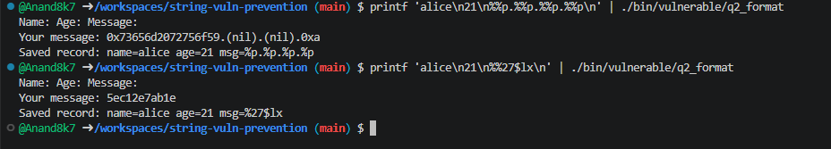
*Placeholder — capture with: `printf 'alice\n21\n%%p.%%p.%%p.%%p\n' | ./bin/vulnerable/q2_format; printf 'alice\n21\n%%27$lx\n' | ./bin/vulnerable/q2_format`*

**Figure 16 — vulnerable Q2: crash via `%s`**
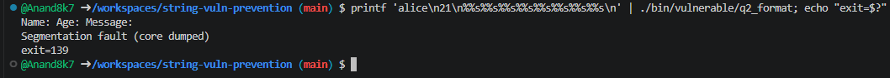
*Placeholder — capture with: `printf 'alice\n21\n%%s%%s%%s%%s%%s%%s%%s%%s\n' | ./bin/vulnerable/q2_format; echo "exit=$?"`*

#### Vulnerable version — input validation

<!-- BEGIN OUTPUT q2_03_vuln_validation.txt -->
*Real output — `docs/report/outputs/q2_03_vuln_validation.txt`*

```text
$ printf 'alice\nabc\nhello\n' | ./bin/vulnerable/q2_format
Name: Age: Message: 
Your message: abc
Saved record: name=alice age=0 msg=abc
[exit code: 0]

$ printf 'John Smith\n21\nhello\n' | ./bin/vulnerable/q2_format
Name: Age: Message: 
Your message: Smith
Saved record: name=John age=0 msg=Smith
[exit code: 0]

$ printf 'alice\n-5\nhello\n' | ./bin/vulnerable/q2_format
Name: Age: Message: 
Your message: hello
Saved record: name=alice age=-5 msg=hello
[exit code: 0]

$ printf 'alice\n99999999999999999999\nhello\n' | ./bin/vulnerable/q2_format
Name: Age: Message: 
Your message: hello
Saved record: name=alice age=-1 msg=hello
[exit code: 0]

$ printf 'AAAAAAAAAAAAAAAAAAAAAAAAAAAAAAAAAAAAAAAA\n21\nhello\n' | ./bin/vulnerable/q2_format
bash: line 1: 64057 Done                    printf 'AAAAAAAAAAAAAAAAAAAAAAAAAAAAAAAAAAAAAAAA\n21\nhello\n'
     64058 Segmentation fault      (core dumped) | ./bin/vulnerable/q2_format
[exit code: 139]
```
<!-- END OUTPUT -->

* `abc` as age: `scanf("%d")` failed, `age` stayed `0` (uninitialised — the
  value is whatever was on the stack), and `abc` became the **message**.
* `John Smith`: split at the space — name `John`, the failed age read leaves
  `Smith`, which becomes the message.
* `-5`: accepted without complaint.
* `99999999999999999999`: silently stored as `age=-1`.
* 40-character name: crash (SIGSEGV).

**Figure 15 — vulnerable Q2: validation failures**
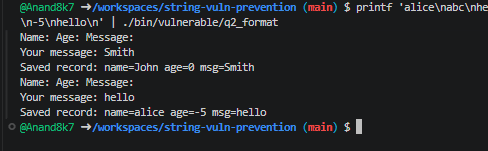
*Placeholder — capture with: `printf 'alice\nabc\nhello\n' | ./bin/vulnerable/q2_format; printf 'John Smith\n21\nhello\n' | ./bin/vulnerable/q2_format; printf 'alice\n-5\nhello\n' | ./bin/vulnerable/q2_format`*

#### Secure version

<!-- BEGIN OUTPUT q2_05_secure_runs.txt -->
*Real output — `docs/report/outputs/q2_05_secure_runs.txt`*

```text
$ printf 'alice\n21\nhello\n' | ./bin/secure/q2_format
Name: Age: Message: 
Your message: hello
Saved record: name=alice age=21 msg=hello
[exit code: 0]

$ printf 'John Smith\n21\nGreat course, 10/10!\n' | ./bin/secure/q2_format
Name: Age: Message: 
Your message: Great course, 10/10!
Saved record: name=John Smith age=21 msg=Great course, 10/10!
[exit code: 0]

$ printf 'alice\n21\n%%p.%%p.%%p.%%p\n' | ./bin/secure/q2_format
Name: Age: Message: 
Your message: %p.%p.%p.%p
Saved record: name=alice age=21 msg=%p.%p.%p.%p
[exit code: 0]

$ printf 'alice\n21\n%%27$lx\n' | ./bin/secure/q2_format
Name: Age: Message: 
Your message: %27$lx
Saved record: name=alice age=21 msg=%27$lx
[exit code: 0]

$ printf 'alice\n21\n%%s%%s%%s%%s%%s%%s%%s%%s\n' | ./bin/secure/q2_format
Name: Age: Message: 
Your message: %s%s%s%s%s%s%s%s
Saved record: name=alice age=21 msg=%s%s%s%s%s%s%s%s
[exit code: 0]

$ printf 'alice\nabc\nhello\n' | ./bin/secure/q2_format
Name: Age: Message: REJECTED: age is not a whole number

[exit code: 2]

$ printf 'alice\n-5\nhello\n' | ./bin/secure/q2_format
Name: Age: Message: REJECTED: age is out of range (1-120)

[exit code: 2]

$ printf 'AAAAAAAAAAAAAAAAAAAAAAAAAAAAAAAAAAAAAAAA\n21\nhello\n' | ./bin/secure/q2_format
Name: REJECTED: name is too long (max 15 characters)
[exit code: 2]

$ printf 'abcdefghijklmno\n120\n%s\n' $(printf 'B%.0s' {1..40}) | ./bin/secure/q2_format
Name: Age: Message: REJECTED: record would exceed 63 characters (SS_TRUNCATED)

[exit code: 2]
```
<!-- END OUTPUT -->

* `%p.%p.%p.%p`, `%27$lx` and `%s%s…` are accepted as ordinary text and
  printed **literally** — no leak, no crash.
* `John Smith` and `Great course, 10/10!` are read as whole lines.
* Invalid ages and over-long names are rejected with a reason.
* A 15-character name + age 120 + 40-character message are each valid, but
  the record would need 73 characters; `safe_format` returns `SS_TRUNCATED`
  and the input is rejected.

**Figure 17 — secure Q2**
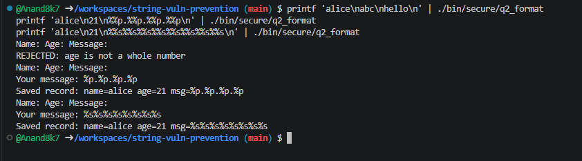
*Placeholder — capture with the same `printf ... |` commands as Figures 14–16, but piped into `./bin/secure/q2_format`*

### 5.7 Security analysis

| Bug | Code (vulnerable) | CWE | Impact observed | Fix (secure) |
|-----|-------------------|-----|-----------------|--------------|
| B1 | `scanf("%s", name)`, `scanf("%s", msg)` | CWE-120; CWE-242 Use of Inherently Dangerous Function | 40-char name → SIGSEGV; `John Smith` split into two fields | `input_read_line` (bounded `fgets`, drains over-long lines), length limits 15/40 |
| B2 | `scanf("%d", &age)` result ignored, no range | CWE-252 Unchecked Return Value; CWE-20; CWE-457 Uninitialised Variable; CWE-190 Integer Overflow | `abc` shifts into the message; `-5` accepted; 20 digits → `age=-1` | `validate_integer`: digits only, 1–120, overflow detected |
| B3 | `sprintf(record, "name=%s age=%d msg=%s", ...)` | CWE-120; CWE-787 | 60-char message → ASan stack-buffer-overflow (WRITE of size 83 into `record[64]`) | `safe_format` (`vsnprintf`), reject on `SS_TRUNCATED` |
| B4 | `printf(msg)` | CWE-134 Use of Externally-Controlled Format String; CWE-200 Exposure of Sensitive Information | stack values printed; simulated secret leaked; `%s` × 8 → SIGSEGV | `printf("%s\n", msg)` — fixed format strings only |

Relevant SEI CERT C rules: **FIO30-C** (exclude user input from format
strings), **FIO47-C** (use valid format strings), **ERR33-C** (detect and
handle standard library errors), **ERR34-C** (detect errors when converting a
string to a number), **STR31-C**, **MSC24-C** (do not use deprecated or
obsolescent functions).

### 5.8 Test cases

For accepted inputs the Q2 script additionally checks that the secure output
echoes the message **literally** and that the secret value `5ec12e7ab1e`
never appears.

| ID | Category | Input (name / age / message) | Vulnerable (observed) | Secure |
|----|----------|------------------------------|-----------------------|--------|
| Q2-01 | Normal | alice / 21 / hello | OK | ACCEPT |
| Q2-02 | Normal | John Smith / 21 / Great course, 10/10! | fields mixed up | ACCEPT |
| Q2-03 | Normal | alice / 21 / 50% off! | format interpreted | ACCEPT (literal) |
| Q2-04 | Boundary | name 15 chars | OK | ACCEPT |
| Q2-05 | Boundary | name 16 chars | accepted; ASan stack-buffer-overflow | REJECT – too long |
| Q2-06 | Boundary | age 1 | OK | ACCEPT |
| Q2-07 | Boundary | age 120 | OK | ACCEPT |
| Q2-08 | Boundary | age 0 | accepted | REJECT – out of range |
| Q2-09 | Boundary | age 121 | accepted | REJECT – out of range |
| Q2-10 | Boundary | message 40 chars | OK | ACCEPT |
| Q2-11 | Boundary | message 41 chars | accepted | REJECT – too long |
| Q2-12 | Boundary | record exactly 63 chars | OK | ACCEPT |
| Q2-13 | Boundary | record 73 chars | `record[64]` overflowed; ASan stack-buffer-overflow | REJECT – record too long |
| Q2-14 | Invalid | age `abc` | fields mixed up | REJECT – not a number |
| Q2-15 | Invalid | age `-5` | accepted | REJECT – out of range |
| Q2-16 | Invalid | age 20 digits | age silently = -1 | REJECT – too long |
| Q2-17 | Invalid | name `bob;ls` | accepted | REJECT – bad char |
| Q2-18 | Invalid | message `hi <b>` | fields mixed up | REJECT – bad char |
| Q2-19 | Invalid | `%p.%p.%p.%p` | format interpreted (stack values printed) | ACCEPT (literal) |
| Q2-20 | Invalid | `%27$lx` | **LEAK: secret_token** | ACCEPT (literal) |
| Q2-21 | Invalid | `%s` × 8 | CRASH (SIGSEGV) | ACCEPT (literal) |
| Q2-22 | Oversized | name 40 chars | CRASH (SIGSEGV) | REJECT – too long |
| Q2-23 | Oversized | name 5000 chars | CRASH (SIGSEGV) | REJECT – too long |
| Q2-24 | Oversized | message 60 chars | `record[64]` overflowed | REJECT – too long |
| Q2-25 | Oversized | message 200 chars | CRASH (SIGSEGV) | REJECT – too long |
| Q2-26 | Invalid | message missing (EOF) | fields mixed up (uninitialised `msg`) | REJECT – missing |

Full automated run:

<!-- BEGIN OUTPUT q2_06_tests.txt -->
*Real output — `docs/report/outputs/q2_06_tests.txt`*

```text
$ bash tests/scenarios/q2_format.sh | grep -v '^TF_RESULT'

=== Scenario suite: q2_format (vulnerable vs secure) ===
+-------+-----------+------------------------------+--------------------------+--------------------------------+--------+------------------------------+-------+--------+
| ID    | Category  | Input                        | Vulnerable (plain)       | Vulnerable (ASan build)        | Expect | Secure result                | S+ASn | Result |
+-------+-----------+------------------------------+--------------------------+--------------------------------+--------+------------------------------+-------+--------+
| Q2-01 | Normal    | alice / 21 / hello           | OK (no visible effect)   | OK (no visible effect)         | ACCEPT | ACCEPT                       | clean | PASS   |
| Q2-02 | Normal    | name with space, msg w/ punc | age silently = 0         | NOT DETECTED: age silently = 0 | ACCEPT | ACCEPT                       | clean | PASS   |
| Q2-03 | Normal    | msg "50% off!" (literal %)   | format interpreted       | NOT DETECTED: format interpret | ACCEPT | ACCEPT                       | clean | PASS   |
| Q2-04 | Boundary  | name 15 chars (max)          | OK (no visible effect)   | OK (no visible effect)         | ACCEPT | ACCEPT                       | clean | PASS   |
| Q2-05 | Boundary  | name 16 chars (max+1)        | invalid input accepted   | ASan: stack-buffer-overflow    | REJECT | REJECT: name too long        | clean | PASS   |
| Q2-06 | Boundary  | age 1 (min)                  | OK (no visible effect)   | OK (no visible effect)         | ACCEPT | ACCEPT                       | clean | PASS   |
| Q2-07 | Boundary  | age 120 (max)                | OK (no visible effect)   | OK (no visible effect)         | ACCEPT | ACCEPT                       | clean | PASS   |
| Q2-08 | Boundary  | age 0 (min-1)                | invalid input accepted   | NOT DETECTED: invalid input ac | REJECT | REJECT: age out of range     | clean | PASS   |
| Q2-09 | Boundary  | age 121 (max+1)              | invalid input accepted   | NOT DETECTED: invalid input ac | REJECT | REJECT: age out of range     | clean | PASS   |
| Q2-10 | Boundary  | message 40 chars (max)       | OK (no visible effect)   | OK (no visible effect)         | ACCEPT | ACCEPT                       | clean | PASS   |
| Q2-11 | Boundary  | message 41 chars (max+1)     | invalid input accepted   | NOT DETECTED: invalid input ac | REJECT | REJECT: message too long     | clean | PASS   |
| Q2-12 | Boundary  | record 63 chars (exact fit)  | OK (no visible effect)   | OK (no visible effect)         | ACCEPT | ACCEPT                       | clean | PASS   |
| Q2-13 | Boundary  | record 73 chars (too long)   | record[64] overflowed    | ASan: stack-buffer-overflow    | REJECT | REJECT: record too long      | clean | PASS   |
| Q2-14 | Invalid   | age "abc" (not a number)     | fields mixed up          | NOT DETECTED: fields mixed up  | REJECT | REJECT: age not a number     | clean | PASS   |
| Q2-15 | Invalid   | age "-5" (negative)          | invalid input accepted   | NOT DETECTED: invalid input ac | REJECT | REJECT: age out of range     | clean | PASS   |
| Q2-16 | Invalid   | age 20 digits (overflow)     | age silently = -1        | NOT DETECTED: age silently = - | REJECT | REJECT: age too long         | clean | PASS   |
| Q2-17 | Invalid   | name "bob;ls"                | invalid input accepted   | NOT DETECTED: invalid input ac | REJECT | REJECT: name bad char        | clean | PASS   |
| Q2-18 | Invalid   | message "hi <b>"             | fields mixed up          | NOT DETECTED: fields mixed up  | REJECT | REJECT: message bad char     | clean | PASS   |
| Q2-19 | Invalid   | fmt: %p.%p.%p.%p             | format interpreted       | NOT DETECTED: format interpret | ACCEPT | ACCEPT                       | clean | PASS   |
| Q2-20 | Invalid   | fmt: %27$lx (reads secret)   | LEAK: secret_token       | NOT DETECTED: format interpret | ACCEPT | ACCEPT                       | clean | PASS   |
| Q2-21 | Invalid   | fmt: %s x 8                  | CRASH (SIGSEGV)          | NOT DETECTED: format interpret | ACCEPT | ACCEPT                       | clean | PASS   |
| Q2-22 | Oversized | name 40 chars                | CRASH (SIGSEGV)          | ASan: stack-buffer-overflow    | REJECT | REJECT: name too long        | clean | PASS   |
| Q2-23 | Oversized | name 5000 chars              | CRASH (SIGSEGV)          | ASan: stack-buffer-overflow    | REJECT | REJECT: name too long        | clean | PASS   |
| Q2-24 | Oversized | message 60 chars             | record[64] overflowed    | ASan: stack-buffer-overflow    | REJECT | REJECT: message too long     | clean | PASS   |
| Q2-25 | Oversized | message 200 chars            | CRASH (SIGSEGV)          | ASan: stack-buffer-overflow    | REJECT | REJECT: message too long     | clean | PASS   |
| Q2-26 | Invalid   | message missing (EOF)        | fields mixed up          | NOT DETECTED: invalid input ac | REJECT | REJECT: message missing      | clean | PASS   |
+-------+-----------+------------------------------+--------------------------+--------------------------------+--------+------------------------------+-------+--------+
Summary [q2_format]: 26/26 passed, 0 failed
Full program output for every run: analysis/logs/scenarios/q2_format/
[exit code: 0]
```
<!-- END OUTPUT -->

**Negative control** (vulnerable binary in place of the secure one):

<!-- BEGIN OUTPUT q2_07_negative_control.txt -->
*Real output — `docs/report/outputs/q2_07_negative_control.txt`*

```text
$ bash tests/scenarios/q2_format.sh | grep '^Summary'
Summary [q2_format]: 6/26 passed, 20 failed
[exit code: 0]
```
<!-- END OUTPUT -->

**Figure 19 — Q2 test table**
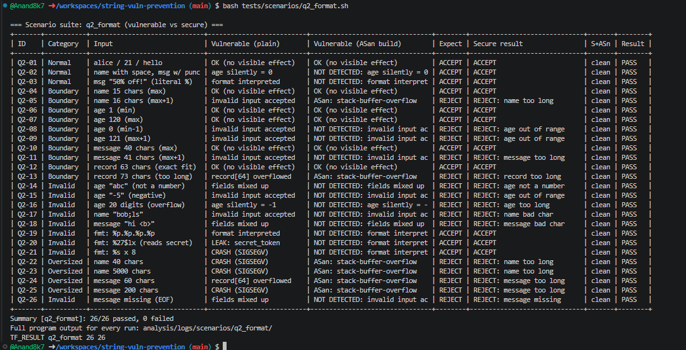
*Placeholder — capture with: `bash tests/scenarios/q2_format.sh` (zoom out)*

### 5.9 Observations and results

#### Compiler warnings — before (vulnerable)

gcc already warns about three of the four Q2 bugs (the vulnerable build
shows these warnings but does not stop):

<!-- BEGIN OUTPUT q2_01_compile_warnings.txt -->
*Real output — `docs/report/outputs/q2_01_compile_warnings.txt`*

```text
$ gcc -std=c11 -Wall -Wextra -O2 -c -o /dev/null src/vulnerable/q2_format.c
src/vulnerable/q2_format.c: In function ‘main’:
src/vulnerable/q2_format.c:58:12: warning: format not a string literal and no format arguments [-Wformat-security]
   58 |     printf(msg);
      |            ^~~
src/vulnerable/q2_format.c:47:5: warning: ignoring return value of ‘scanf’ declared with attribute ‘warn_unused_result’ [-Wunused-result]
   47 |     scanf("%s", name);            /* [B1] unbounded %s */
      |     ^~~~~~~~~~~~~~~~~
src/vulnerable/q2_format.c:50:5: warning: ignoring return value of ‘scanf’ declared with attribute ‘warn_unused_result’ [-Wunused-result]
   50 |     scanf("%d", &age);            /* [B2] result not checked, no range */
      |     ^~~~~~~~~~~~~~~~~
src/vulnerable/q2_format.c:53:5: warning: ignoring return value of ‘scanf’ declared with attribute ‘warn_unused_result’ [-Wunused-result]
   53 |     scanf("%s", msg);             /* [B1] unbounded %s again */
      |     ^~~~~~~~~~~~~~~~
src/vulnerable/q2_format.c:62:41: warning: ‘%s’ directive writing up to 63 bytes into a region of size between 23 and 48 [-Wformat-overflow=]
   62 |     sprintf(record, "name=%s age=%d msg=%s", name, age, msg);
      |                                         ^~              ~~~
In file included from /usr/include/stdio.h:980,
                 from src/vulnerable/q2_format.c:31:
In function ‘sprintf’,
    inlined from ‘main’ at src/vulnerable/q2_format.c:62:5:
/usr/include/x86_64-linux-gnu/bits/stdio2.h:30:10: note: ‘__builtin___sprintf_chk’ output between 17 and 105 bytes into a destination of size 64
   30 |   return __builtin___sprintf_chk (__s, __USE_FORTIFY_LEVEL - 1,
      |          ^~~~~~~~~~~~~~~~~~~~~~~~~~~~~~~~~~~~~~~~~~~~~~~~~~~~~~
   31 |                                   __glibc_objsize (__s), __fmt,
      |                                   ~~~~~~~~~~~~~~~~~~~~~~~~~~~~~
   32 |                                   __va_arg_pack ());
      |                                   ~~~~~~~~~~~~~~~~~
[exit code: 0]
```
<!-- END OUTPUT -->

**Figure 13 — gcc warnings for Q2**
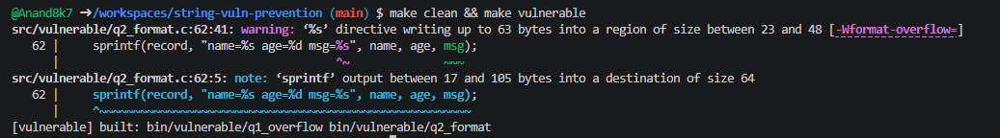
*Placeholder — capture with: `make clean && make vulnerable`*

#### AddressSanitizer — before (vulnerable)

<!-- BEGIN OUTPUT q2_04_asan_record_overflow.txt lines=1-23 -->
*Real output — `docs/report/outputs/q2_04_asan_record_overflow.txt`*

```text
$ printf 'alice\n21\n%s\n' $(printf 'B%.0s' {1..60}) | ./bin/asan/vulnerable_q2_format 2>&1 | head -n 25
=================================================================
==64062==ERROR: AddressSanitizer: stack-buffer-overflow on address 0x741812e00120 at pc 0x741815a15d69 bp 0x7ffce2007a40 sp 0x7ffce20071d0
WRITE of size 83 at 0x741812e00120 thread T0
    #0 0x741815a15d68 in vsprintf ../../../../src/libsanitizer/sanitizer_common/sanitizer_common_interceptors.inc:1671
    #1 0x741815a1751b in sprintf ../../../../src/libsanitizer/sanitizer_common/sanitizer_common_interceptors.inc:1714
    #2 0x5910ee402442 in main src/vulnerable/q2_format.c:62
    #3 0x7418151481c9 in __libc_start_call_main ../sysdeps/nptl/libc_start_call_main.h:58
    #4 0x74181514828a in __libc_start_main_impl ../csu/libc-start.c:360
    #5 0x5910ee4021c4 in _start (bin/asan/vulnerable_q2_format+0x11c4) (BuildId: ec62d8f88313ead17a7f1efb2176e68eeab1df74)

Address 0x741812e00120 is located in stack of thread T0 at offset 288 in frame
    #0 0x5910ee402298 in main src/vulnerable/q2_format.c:38

  This frame has 5 object(s):
    [48, 52) 'age' (line 44)
    [64, 72) 'secret_token' (line 40)
    [96, 112) 'name' (line 41)
    [128, 192) 'msg' (line 42)
    [224, 288) 'record' (line 43) <== Memory access at offset 288 overflows this variable
HINT: this may be a false positive if your program uses some custom stack unwind mechanism, swapcontext or vfork
      (longjmp and C++ exceptions *are* supported)
SUMMARY: AddressSanitizer: stack-buffer-overflow ../../../../src/libsanitizer/sanitizer_common/sanitizer_common_interceptors.inc:1671 in vsprintf
... (4 more lines in docs/report/outputs/q2_04_asan_record_overflow.txt)
```
<!-- END OUTPUT -->

ASan shows `sprintf` writing 83 bytes into `record[64]` (line 62). Note what
ASan did **not** report: the format-string leaks (`%p`, `%27$lx`) and the
validation problems are not memory errors, so the ASan build ran them without
any complaint (test table column "Vulnerable (ASan build)": *NOT DETECTED*).
In the ASan build `%s` × 8 also did not crash, because the stack layout is
different.

**Figure 18 — ASan: record overflow (Q2)**
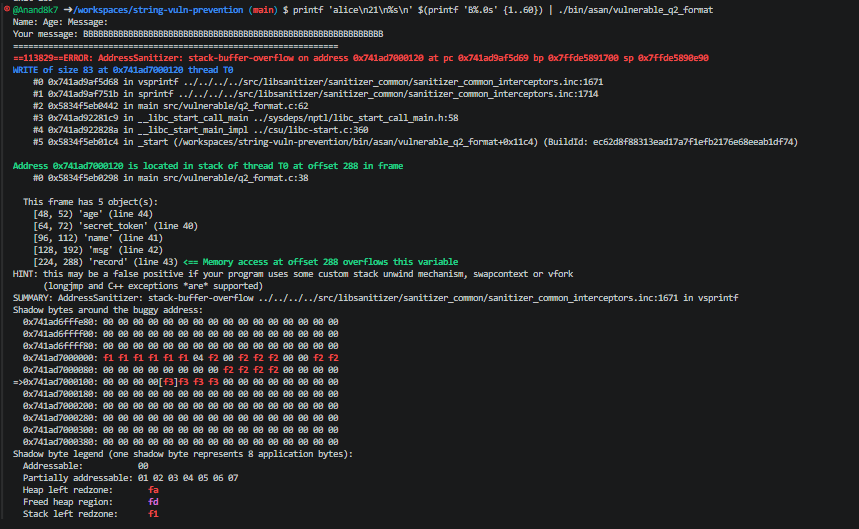
*Placeholder — capture with: `printf 'alice\n21\n%s\n' $(printf 'B%.0s' {1..60}) | ./bin/asan/vulnerable_q2_format`*

#### Before vs after summary

| Check | Vulnerable Q2 | Secure Q2 |
|-------|---------------|-----------|
| gcc warnings | 5: `-Wformat-security` (`printf(msg)`), 3 × `-Wunused-result` (`scanf`), `-Wformat-overflow` (`sprintf`) | 0, builds with `-Werror -Wformat=2` |
| Cppcheck `--enable=all` | 2 × `invalidscanf`; **`printf(msg)` and `sprintf` not reported** | 0 findings |
| Banned-API scan | 7 findings (2 × `scanf("%s")`, 3 × unchecked `scanf`, `printf(var)`, `sprintf`) | 0 findings |
| ASan (5 inputs, Section 6) | 2 × stack-buffer-overflow; format-string bugs **not detected** | no errors |
| Valgrind (same inputs) | 2 × SIGSEGV (`%s` × 8 with uninitialised-value and invalid-read errors; 40-char name) | 0 errors |
| Test cases | 20 of 26 cases show a defect | 26 / 26 PASS |

### 5.10 Learning outcomes

1. `scanf("%s")` is as dangerous as `gets`; reading whole lines with `fgets`
   and then validating is both safer and more correct (`John Smith` works).
2. Every input function's return value must be checked; unchecked
   `scanf("%d")` produced uninitialised values, shifted fields and silent
   integer overflow.
3. Validation should be a whitelist with explicit length and range limits;
   the secure program rejects with a precise reason.
4. A format string must always be a literal. `printf("%s", msg)` removes the
   whole vulnerability class — even when `%` is allowed in the input.
5. Format-string bugs leak data without any memory-safety error, so ASan and
   Valgrind cannot see them; compiler warnings (`-Wformat-security`,
   `-Wformat=2`) and code scanning must be used.

---

## 6. Vulnerability detection and analysis (Module 4)

`make analyze` runs `analysis/run_analysis.sh`, which applies five checks to
both versions and saves every log in `analysis/logs/`:

| Step | Tool | Configuration |
|------|------|---------------|
| 1 | gcc warnings | `-Wall -Wextra -Wformat=2 -Wformat-overflow=2 -Wformat-truncation=2 -Wstringop-overflow=4 -O2` |
| 2 | Cppcheck 2.13 | `--enable=all --std=c11`; the library is analysed together with its callers |
| 3 | Banned-API scan | `analysis/banned_functions.py` — comment-aware scan for `strcpy`, `strcat`, `sprintf`, `gets`, `scanf("%s")`, unchecked `scanf`, `printf(var)`, `atoi` |
| 4 | AddressSanitizer + UBSan | 9 attack-style inputs against `bin/asan/*` |
| 5 | Valgrind memcheck | the same 9 inputs against `bin/vulnerable/*` and `bin/secure/*` |

The banned-API scanner was added because Cppcheck reported **none** of the
`strcpy`/`strcat`/`sprintf`/`printf(msg)` calls (it cannot know how long
`argv` or stdin data will be). The script exits with an error only if the
**secure** code has a finding.

### 6.1 Full analysis run

<!-- BEGIN OUTPUT 91_analysis.txt lines=1-65 -->
*Real output — `docs/report/outputs/91_analysis.txt`*

```text
$ bash analysis/run_analysis.sh
Analysis run: 2026-11-20 15:30:07 UTC
Host:         Linux 6.8.0-1070-azure
gcc:          gcc (Ubuntu 13.3.0-6ubuntu2~24.04.1) 13.3.0
cppcheck:     Cppcheck 2.13.0
valgrind:     valgrind-3.22.0

==================== 1. Compiler warnings (gcc -Wall -Wextra -Wformat=2 ...) ====================
  vulnerable: src/vulnerable/q2_format.c:58:12: warning: format not a string literal and no format arguments [-Wformat-security]
  vulnerable: src/vulnerable/q2_format.c:47:5: warning: ignoring return value of ‘scanf’ declared with attribute ‘warn_unused_result’ [-Wunused-result]
  vulnerable: src/vulnerable/q2_format.c:50:5: warning: ignoring return value of ‘scanf’ declared with attribute ‘warn_unused_result’ [-Wunused-result]
  vulnerable: src/vulnerable/q2_format.c:53:5: warning: ignoring return value of ‘scanf’ declared with attribute ‘warn_unused_result’ [-Wunused-result]
  vulnerable: src/vulnerable/q2_format.c:62:41: warning: ‘%s’ directive writing up to 63 bytes into a region of size between 23 and 48 [-Wformat-overflow=]
vulnerable: 5 warning(s)   secure+lib: 0 warning(s)

==================== 2. Cppcheck (static analysis, --enable=all) ====================
  src/vulnerable/q1_overflow.c:41: style: Parameter 'argv' can be declared as const array [constParameter]
  src/vulnerable/q2_format.c:47: warning: scanf() without field width limits can crash with huge input data. [invalidscanf]
  src/vulnerable/q2_format.c:53: warning: scanf() without field width limits can crash with huge input data. [invalidscanf]
vulnerable: 3 finding(s)   secure+lib+tests: 0 finding(s)

==================== 3. Banned string API scan (analysis/banned_functions.py) ====================
  src/vulnerable/q1_overflow.c:53: [BANNED-strcpy] strcpy() does not know the destination size (CWE-120)
  src/vulnerable/q1_overflow.c:56: [BANNED-strcpy] strcpy() does not know the destination size (CWE-120)
  src/vulnerable/q1_overflow.c:59: [BANNED-strcpy] strcpy() does not know the destination size (CWE-120)
  src/vulnerable/q1_overflow.c:60: [BANNED-strcat] strcat() does not know the destination size (CWE-120)
  src/vulnerable/q1_overflow.c:61: [BANNED-strcat] strcat() does not know the destination size (CWE-120)
  src/vulnerable/q1_overflow.c:64: [BANNED-strcpy] strcpy() does not know the destination size (CWE-120)
  src/vulnerable/q1_overflow.c:65: [BANNED-strcat] strcat() does not know the destination size (CWE-120)
  src/vulnerable/q1_overflow.c:66: [BANNED-strcat] strcat() does not know the destination size (CWE-120)
  src/vulnerable/q1_overflow.c:67: [BANNED-strcat] strcat() does not know the destination size (CWE-120)
  src/vulnerable/q2_format.c:47: [BANNED-scanf-%s] scanf("%s") without a field width (CWE-120)
  src/vulnerable/q2_format.c:47: [UNCHECKED-scanf] scanf() return value is ignored (CWE-252)
  src/vulnerable/q2_format.c:50: [UNCHECKED-scanf] scanf() return value is ignored (CWE-252)
  src/vulnerable/q2_format.c:53: [BANNED-scanf-%s] scanf("%s") without a field width (CWE-120)
  src/vulnerable/q2_format.c:53: [UNCHECKED-scanf] scanf() return value is ignored (CWE-252)
  src/vulnerable/q2_format.c:58: [FORMAT-nonliteral] format string is a variable, not a literal (CWE-134)
  src/vulnerable/q2_format.c:62: [BANNED-sprintf] sprintf() has no output bound; use snprintf (CWE-787)
  banned_functions: 16 finding(s) in 2 file(s)
vulnerable: 16 finding(s)   secure+lib: 0 finding(s)

==================== 4. AddressSanitizer + UBSan (bin/asan/*) ====================
case                     vulnerable                   secure                      
q1_normal                none                         none                        
q1_user20_intra_struct   none                         none                        
q1_path_overflow         stack-buffer-overflow        none                        
q1_user100               stack-buffer-overflow        none                        
q2_normal                none                         none                        
q2_fmt_pointers          none                         none                        
q2_fmt_strings           none                         none                        
q2_record_overflow       stack-buffer-overflow        none                        
q2_name40                stack-buffer-overflow        none                        

==================== 5. Valgrind memcheck (bin/vulnerable/*, bin/secure/*) ====================
case                     vulnerable                   secure                      
q1_normal                0 errors                     0 errors                    
q1_user20_intra_struct   0 errors                     0 errors                    
q1_path_overflow         0 errors                     0 errors                    
q1_user100               3 err, signal 11 (SIGSEGV)   0 errors                    
q2_normal                0 errors                     0 errors                    
q2_fmt_pointers          0 errors                     0 errors                    
q2_fmt_strings           4 err, signal 11 (SIGSEGV)   0 errors                    
q2_record_overflow       0 errors                     0 errors                    
q2_name40                1 err, signal 11 (SIGSEGV)   0 errors                    

... (29 more lines in docs/report/outputs/91_analysis.txt)
```
<!-- END OUTPUT -->

### 6.2 Summary

<!-- BEGIN OUTPUT 91_analysis.txt lines=66-94 -->
*Real output — `docs/report/outputs/91_analysis.txt`*

```text
=========================== ANALYSIS SUMMARY ===========================
+--------------------------------+----------------------------+----------------------------+
| Check                          | Vulnerable version         | Secure version             |
+--------------------------------+----------------------------+----------------------------+
| gcc warnings                   | 5 warning(s)               | 0 warning(s)               |
| cppcheck                       | 3 finding(s)               | 0 finding(s)               |
| banned API scan                | 16 finding(s)              | 0 finding(s)               |
| ASan q1_normal                 | none                       | none                       |
| ASan q1_user20_intra_struct    | none                       | none                       |
| ASan q1_path_overflow          | stack-buffer-overflow      | none                       |
| ASan q1_user100                | stack-buffer-overflow      | none                       |
| ASan q2_normal                 | none                       | none                       |
| ASan q2_fmt_pointers           | none                       | none                       |
| ASan q2_fmt_strings            | none                       | none                       |
| ASan q2_record_overflow        | stack-buffer-overflow      | none                       |
| ASan q2_name40                 | stack-buffer-overflow      | none                       |
| Valgrind q1_normal             | 0 errors                   | 0 errors                   |
| Valgrind q1_user20_intra_struc | 0 errors                   | 0 errors                   |
| Valgrind q1_path_overflow      | 0 errors                   | 0 errors                   |
| Valgrind q1_user100            | 3 err, signal 11 (SIGSEGV) | 0 errors                   |
| Valgrind q2_normal             | 0 errors                   | 0 errors                   |
| Valgrind q2_fmt_pointers       | 0 errors                   | 0 errors                   |
| Valgrind q2_fmt_strings        | 4 err, signal 11 (SIGSEGV) | 0 errors                   |
| Valgrind q2_record_overflow    | 0 errors                   | 0 errors                   |
| Valgrind q2_name40             | 1 err, signal 11 (SIGSEGV) | 0 errors                   |
+--------------------------------+----------------------------+----------------------------+
RESULT: secure code is CLEAN in every check.
Logs: analysis/logs/
[exit code: 0]
```
<!-- END OUTPUT -->

**Figure 24 — analysis summary**
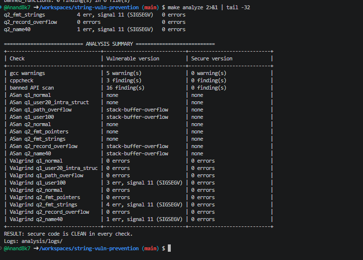
*Placeholder — capture with: `make analyze 2>&1 | tail -32`*

### 6.3 Cppcheck before and after

<!-- BEGIN OUTPUT 92_cppcheck_vulnerable.txt -->
*Real output — `docs/report/outputs/92_cppcheck_vulnerable.txt`*

```text
$ cppcheck --enable=all --std=c11 --suppress=missingIncludeSystem --suppress=checkersReport -Isrc/lib -q src/vulnerable
src/vulnerable/q1_overflow.c:41:26: style: Parameter 'argv' can be declared as const array [constParameter]
int main(int argc, char *argv[])
                         ^
src/vulnerable/q2_format.c:47:5: warning: scanf() without field width limits can crash with huge input data. [invalidscanf]
    scanf("%s", name);            /* [B1] unbounded %s */
    ^
src/vulnerable/q2_format.c:53:5: warning: scanf() without field width limits can crash with huge input data. [invalidscanf]
    scanf("%s", msg);             /* [B1] unbounded %s again */
    ^
[exit code: 0]
```
<!-- END OUTPUT -->

<!-- BEGIN OUTPUT 93_cppcheck_secure.txt -->
*Real output — `docs/report/outputs/93_cppcheck_secure.txt`*

```text
$ cppcheck --enable=all --std=c11 --suppress=missingIncludeSystem --suppress=checkersReport -Isrc/lib -q src/secure src/lib tests
[exit code: 0]
```
<!-- END OUTPUT -->

**Figure 22 — Cppcheck: vulnerable vs secure**
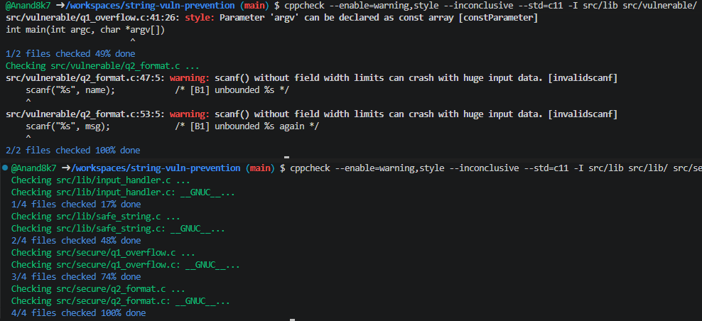
*Placeholder — capture with: `cppcheck --enable=all --std=c11 --suppress=missingIncludeSystem --suppress=checkersReport -Isrc/lib -q src/vulnerable; echo "---- secure ----"; cppcheck --enable=all --std=c11 --suppress=missingIncludeSystem --suppress=checkersReport -Isrc/lib -q src/secure src/lib tests; echo "exit=$?"`*

**Figure 23 — banned-API scan**
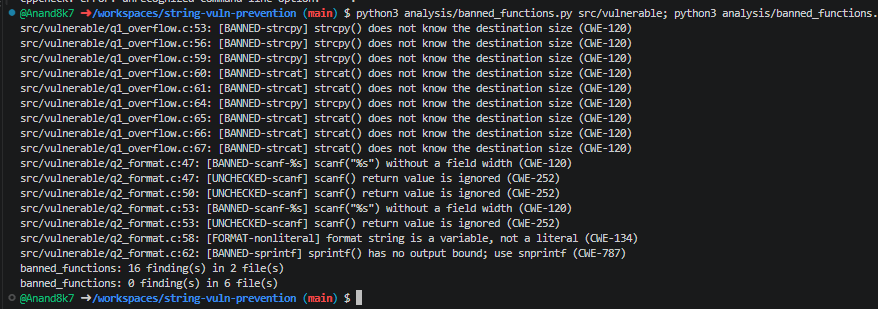
*Placeholder — capture with: `python3 analysis/banned_functions.py src/vulnerable; python3 analysis/banned_functions.py src/secure src/lib`*

### 6.4 Which tool found what

| Vulnerability | gcc warnings | Cppcheck | Banned-API scan | ASan | Valgrind | FORTIFY | Test cases |
|---------------|:-:|:-:|:-:|:-:|:-:|:-:|:-:|
| `strcpy` overflow into struct field (`role`) | – | – | ✔ | – (intra-object) | – | ✔ | ✔ |
| `strcat` overflow of `path` / `greeting` | – | – | ✔ | ✔ | – (until crash) | not tested | ✔ |
| Return address overwritten (100 chars) | – | – | ✔ | ✔ | ✔ (jump to `0x4141…`) | not tested | ✔ (crash) |
| `scanf("%s")` without width | – | ✔ | ✔ | ✔ (on overflow) | ✔ (crash at 40) | not tested | ✔ |
| unchecked `scanf("%d")` / no range | ✔ (`-Wunused-result`) | – | ✔ | – | – | – | ✔ |
| `sprintf` overflow of `record` | ✔ | – | ✔ | ✔ | – | not tested | ✔ |
| `printf(msg)` format string | ✔ | – | ✔ | – | ✔ (only `%s` crash) | – | ✔ |

(✔ = reported in our runs, – = not reported in our runs, "not tested" = not
run in that configuration.)

**Conclusion of the analysis:** every tool missed something. The secure code
does not depend on any one of them: bounded APIs and validation prevent the
bugs, and the tools plus the tests confirm it.

---

## 7. Testing and evaluation (Module 5)

`make test` builds all versions and runs:

* `bin/tests/test_safe_string` — 55 unit tests (safe_strlen, safe_copy,
  safe_concat, safe_format, validate_input, validate_integer)
* `bin/tests/test_input_handler` — 25 unit tests (input_read_line,
  input_from_arg, input_read_file)
* `tests/scenarios/q1_overflow.sh` — 17 cases × 4 builds
* `tests/scenarios/q2_format.sh` — 26 cases × 4 builds

<!-- BEGIN OUTPUT 90_make_test_summary.txt -->
*Real output — `docs/report/outputs/90_make_test_summary.txt`*

```text
$ make test 2>&1 | tail -n 11

=================== OVERALL TEST SUMMARY ===================
Suite                          Passed    Total   Result
----------------------------   ------    -----   ------
input_handler                      25       25     PASS
safe_string                        55       55     PASS
q1_overflow                        17       17     PASS
q2_format                          26       26     PASS
----------------------------   ------    -----   ------
TOTAL                             123      123     PASS
============================================================
[exit code: 0]
```
<!-- END OUTPUT -->

**Figure 20 — overall test summary**
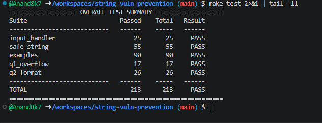
*Placeholder — capture with: `make test 2>&1 | tail -11`*

| Category | Q1 cases | Q2 cases | Vulnerable: defect observed | Secure: correct |
|----------|:-:|:-:|:-:|:-:|
| Normal | 2 | 3 | 2 of 5 (Q2-02, Q2-03) | 5 / 5 |
| Boundary | 5 | 10 | 8 of 15 | 15 / 15 |
| Invalid | 5 | 9 | 13 of 14 (all except Q1-12 usage error) | 14 / 14 |
| Oversized | 5 | 4 | 9 of 9 | 9 / 9 |
| **Total** | **17** | **26** | **32 of 43** | **43 / 43** |

Testing quality checks:

* **Negative controls:** replacing the secure binary with the vulnerable one
  makes 12/17 (Q1) and 20/26 (Q2) cases fail (Sections 4.8, 5.8).
* **Mutation check:** a `safe_copy` without its bound fails 5 unit tests
  (Section 3.3).
* **Sanitizers in tests:** unit tests and the secure ASan builds run under
  ASan + UBSan; any memory error fails the test.

---

## 8. Continuous integration

`.github/workflows/ci.yml` runs on every push and pull request on
`ubuntu-24.04`:

1. install `build-essential`, `cppcheck`, `valgrind`
2. `make all asan` (secure code must compile with `-Werror`)
3. `make test` (all 123 tests)
4. Cppcheck on `src/secure src/lib tests` with `--error-exitcode=1`
5. Cppcheck on `src/vulnerable` (informational only)
6. banned-API scan on `src/secure src/lib` (must be clean)
7. `make analyze`
8. upload `analysis/logs/` as the `analysis-logs` artifact

Any unsafe change to the secure code — for example re-introducing `strcpy` or
`printf(msg)` — therefore fails the build.

**Figure 25 — GitHub Actions run**
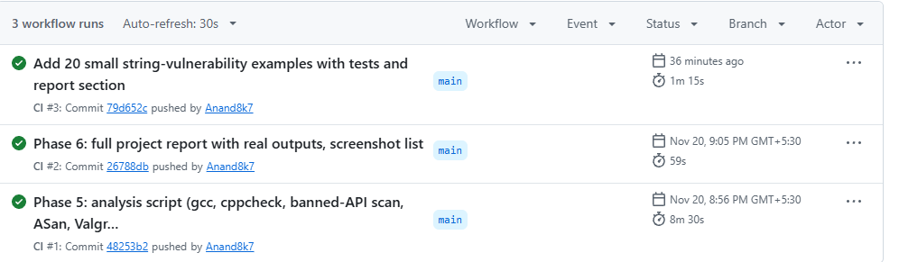
*Placeholder — capture in the browser: repository → **Actions** tab → latest
"CI" run, with all steps green.*

---

## 9. Conclusion and future work

### 9.1 Conclusion

The project implemented the Phase-I design end to end. The vulnerable
programs demonstrated, with real output, the consequences of unbounded string
functions and unsafe formatting: silent corruption of a privilege-relevant
field, corruption of neighbouring buffers, an overwritten return address,
leakage of a simulated secret, and crashes. The secure programs, built on a
small safe-string library and the workflow *Input → Validation → Length check
→ Safe handling → Output verification → Result*, rejected every malicious or
malformed input with a clear reason and passed all 123 tests with ASan and
UBSan enabled. All analysis tools report zero findings in the secure code.

The comparison of tools was one of the most useful results: AddressSanitizer
missed the intra-struct overflow, Valgrind missed every stack overflow until
the crash, Cppcheck missed `strcpy`, `strcat`, `sprintf` and `printf(msg)`,
and none of them can see missing validation. Prevention by design, supported
by several detection layers and systematic tests, is what made the secure
version reliable.

### 9.2 Future work

* Add fuzzing (libFuzzer or AFL++) for `validate_input` and `input_read_line`.
* Compare with C11 Annex K (`strcpy_s`, `strcat_s`) and `strlcpy`/`strlcat`.
* Add `clang --analyze` and the `-fanalyzer` option of gcc to the analysis.
* Extend the library to UTF-8 aware validation.

---

## 10. References

1. MITRE, *Common Weakness Enumeration*: CWE-20, CWE-120, CWE-121, CWE-134,
   CWE-158, CWE-170, CWE-190, CWE-193, CWE-195, CWE-200, CWE-242, CWE-252,
   CWE-457, CWE-787. https://cwe.mitre.org/
2. SEI CERT C Coding Standard: STR31-C, STR32-C, STR07-C, FIO30-C, FIO47-C,
   ERR33-C, ERR34-C, MSC24-C. https://wiki.sei.cmu.edu/confluence/display/c
3. R. C. Seacord, *Secure Coding in C and C++*, 2nd ed., Addison-Wesley, 2013.
4. ISO/IEC 9899:2011, *Programming languages — C* (C11), incl. Annex K.
5. AddressSanitizer documentation. https://github.com/google/sanitizers/wiki/AddressSanitizer
6. Valgrind User Manual — Memcheck. https://valgrind.org/docs/manual/mc-manual.html
7. Cppcheck manual. https://cppcheck.sourceforge.io/manual.pdf
8. GCC manual — Warning options (`-Wformat`, `-Wformat-security`,
   `-Wformat-overflow`) and `_FORTIFY_SOURCE`. https://gcc.gnu.org/onlinedocs/

---

## Appendix A — Reproducing every result

```bash
sudo apt-get install -y build-essential cppcheck valgrind
git clone https://github.com/Anand8k7/string-vuln-prevention.git
cd string-vuln-prevention

make clean && make all asan     # build
make test                       # 123 tests
make analyze                    # gcc, cppcheck, banned scan, ASan, Valgrind

# regenerate every output shown in this report and refresh the report
bash docs/report/collect_outputs.sh
python3 docs/report/render_report.py
```

Build output (vulnerable build shows the Q2 warnings; secure build is
`-Werror`-clean):

<!-- BEGIN OUTPUT 01_build.txt -->
*Real output — `docs/report/outputs/01_build.txt`*

```text
$ make all asan
gcc -std=c11 -Wall -Wextra -O0 -g -fno-stack-protector -U_FORTIFY_SOURCE -D_FORTIFY_SOURCE=0 -Wno-error src/vulnerable/q1_overflow.c -o bin/vulnerable/q1_overflow 
gcc -std=c11 -Wall -Wextra -O0 -g -fno-stack-protector -U_FORTIFY_SOURCE -D_FORTIFY_SOURCE=0 -Wno-error src/vulnerable/q2_format.c -o bin/vulnerable/q2_format 
src/vulnerable/q2_format.c: In function ‘main’:
src/vulnerable/q2_format.c:58:12: warning: format not a string literal and no format arguments [-Wformat-security]
   58 |     printf(msg);
      |            ^~~
src/vulnerable/q2_format.c:62:41: warning: ‘%s’ directive writing up to 63 bytes into a region of size between 23 and 48 [-Wformat-overflow=]
   62 |     sprintf(record, "name=%s age=%d msg=%s", name, age, msg);
      |                                         ^~              ~~~
src/vulnerable/q2_format.c:62:5: note: ‘sprintf’ output between 17 and 105 bytes into a destination of size 64
   62 |     sprintf(record, "name=%s age=%d msg=%s", name, age, msg);
      |     ^~~~~~~~~~~~~~~~~~~~~~~~~~~~~~~~~~~~~~~~~~~~~~~~~~~~~~~~
[vulnerable] built: bin/vulnerable/q1_overflow bin/vulnerable/q2_format
gcc -std=c11 -Wall -Wextra -Werror -Wpedantic -Wformat=2 -Wformat-security -Wformat-overflow=2 -Wformat-truncation=2 -Wstringop-overflow=4 -Wshadow -Wconversion -Wsign-conversion -O2 -D_FORTIFY_SOURCE=2 -fstack-protector-strong -fPIE -Isrc/lib -c src/lib/input_handler.c -o bin/lib/input_handler.o
gcc -std=c11 -Wall -Wextra -Werror -Wpedantic -Wformat=2 -Wformat-security -Wformat-overflow=2 -Wformat-truncation=2 -Wstringop-overflow=4 -Wshadow -Wconversion -Wsign-conversion -O2 -D_FORTIFY_SOURCE=2 -fstack-protector-strong -fPIE -Isrc/lib -c src/lib/safe_string.c -o bin/lib/safe_string.o
gcc -std=c11 -Wall -Wextra -Werror -Wpedantic -Wformat=2 -Wformat-security -Wformat-overflow=2 -Wformat-truncation=2 -Wstringop-overflow=4 -Wshadow -Wconversion -Wsign-conversion -O2 -D_FORTIFY_SOURCE=2 -fstack-protector-strong -fPIE -Isrc/lib src/secure/q1_overflow.c bin/lib/input_handler.o bin/lib/safe_string.o -o bin/secure/q1_overflow -pie -Wl,-z,relro,-z,now
gcc -std=c11 -Wall -Wextra -Werror -Wpedantic -Wformat=2 -Wformat-security -Wformat-overflow=2 -Wformat-truncation=2 -Wstringop-overflow=4 -Wshadow -Wconversion -Wsign-conversion -O2 -D_FORTIFY_SOURCE=2 -fstack-protector-strong -fPIE -Isrc/lib src/secure/q2_format.c bin/lib/input_handler.o bin/lib/safe_string.o -o bin/secure/q2_format -pie -Wl,-z,relro,-z,now
[secure] built: bin/secure/q1_overflow bin/secure/q2_format
gcc -std=c11 -Wall -Wextra -O1 -g -fno-omit-frame-pointer -U_FORTIFY_SOURCE -D_FORTIFY_SOURCE=0 -fsanitize=address,undefined -Isrc/lib src/vulnerable/q1_overflow.c -o bin/asan/vulnerable_q1_overflow -fsanitize=address,undefined
gcc -std=c11 -Wall -Wextra -O1 -g -fno-omit-frame-pointer -U_FORTIFY_SOURCE -D_FORTIFY_SOURCE=0 -fsanitize=address,undefined -Isrc/lib src/vulnerable/q2_format.c -o bin/asan/vulnerable_q2_format -fsanitize=address,undefined
src/vulnerable/q2_format.c: In function ‘main’:
src/vulnerable/q2_format.c:58:12: warning: format not a string literal and no format arguments [-Wformat-security]
   58 |     printf(msg);
      |            ^~~
src/vulnerable/q2_format.c:62:41: warning: ‘%s’ directive writing up to 63 bytes into a region of size between 23 and 48 [-Wformat-overflow=]
   62 |     sprintf(record, "name=%s age=%d msg=%s", name, age, msg);
      |                                         ^~              ~~~
src/vulnerable/q2_format.c:62:5: note: ‘sprintf’ output between 17 and 105 bytes into a destination of size 64
   62 |     sprintf(record, "name=%s age=%d msg=%s", name, age, msg);
      |     ^~~~~~~~~~~~~~~~~~~~~~~~~~~~~~~~~~~~~~~~~~~~~~~~~~~~~~~~
gcc -std=c11 -Wall -Wextra -O1 -g -fno-omit-frame-pointer -U_FORTIFY_SOURCE -D_FORTIFY_SOURCE=0 -fsanitize=address,undefined -Isrc/lib src/secure/q1_overflow.c src/lib/input_handler.c src/lib/safe_string.c -o bin/asan/secure_q1_overflow -fsanitize=address,undefined
gcc -std=c11 -Wall -Wextra -O1 -g -fno-omit-frame-pointer -U_FORTIFY_SOURCE -D_FORTIFY_SOURCE=0 -fsanitize=address,undefined -Isrc/lib src/secure/q2_format.c src/lib/input_handler.c src/lib/safe_string.c -o bin/asan/secure_q2_format -fsanitize=address,undefined
[asan] built: bin/asan/vulnerable_q1_overflow bin/asan/vulnerable_q2_format bin/asan/secure_q1_overflow bin/asan/secure_q2_format
[exit code: 0]
```
<!-- END OUTPUT -->

## Appendix B — List of figures (screenshots)

All screenshots are listed with their exact commands in
[`screenshots/SCREENSHOT_LIST.md`](../../screenshots/SCREENSHOT_LIST.md).

| Figure | File | Section |
|--------|------|---------|
| 1 | `01_toolchain_versions.png` | 4.3 Requirements / setup |
| 2 | `02_repo_structure.png` | 2.3 Repository structure |
| 3 | `03_make_help.png` | 2.4 Build configurations |
| 4 | `04_unit_tests_safe_string.png` | 3.3 Unit tests |
| 5 | `05_unit_tests_input_handler.png` | 3.3 Unit tests |
| 6 | `06_valgrind_unit_tests.png` | 3.3 Unit tests |
| 7 | `07_q1_vuln_normal_vs_overflow.png` | 4.6 Q1 expected output |
| 8 | `08_q1_vuln_segfault.png` | 4.6 Q1 expected output |
| 9 | `09_q1_asan_stack_overflow.png` | 4.9 Q1 observations |
| 10 | `10_q1_asan_misses_intra_struct.png` | 4.9 Q1 observations |
| 11 | `11_q1_secure_rejects.png` | 4.6 Q1 expected output |
| 12 | `12_q1_test_table.png` | 4.8 Q1 test cases |
| 13 | `13_q2_gcc_warnings.png` | 5.9 Q2 observations |
| 14 | `14_q2_vuln_format_leak.png` | 5.6 Q2 expected output |
| 15 | `15_q2_vuln_validation.png` | 5.6 Q2 expected output |
| 16 | `16_q2_vuln_crash.png` | 5.6 Q2 expected output |
| 17 | `17_q2_secure.png` | 5.6 Q2 expected output |
| 18 | `18_q2_asan_record_overflow.png` | 5.9 Q2 observations |
| 19 | `19_q2_test_table.png` | 5.8 Q2 test cases |
| 20 | `20_all_tests_summary.png` | 7 Testing and evaluation |
| 21 | `21_q1_valgrind_ret_overwrite.png` | 4.9 Q1 observations |
| 22 | `22_cppcheck_before_after.png` | 6.3 Cppcheck before and after |
| 23 | `23_banned_api_scan.png` | 6.3 Banned-API scan |
| 24 | `24_analysis_summary.png` | 6.2 Analysis summary |
| 25 | `25_ci_github_actions.png` | 8 Continuous integration |
